<div align="center">

# framio

**A cheap Android photo frame, turned into a calm, ad-free screen for the things that actually help your day.**

🖼️ **The frame I use:** [Veidoo F10 Frameo photo frame on Amazon](https://link.amazon/B0iuSehw6)<br>
<sub>I'm trying affiliate so support me by using this link: as an Amazon Associate I earn from qualifying purchases, at no extra cost to you.</sub>

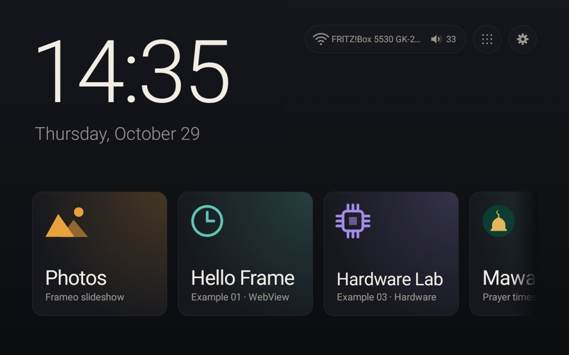

*Focus timer · prayer times · learning for kids · a hardware lab · and still your family photos.*

<table>
  <tr>
    <td>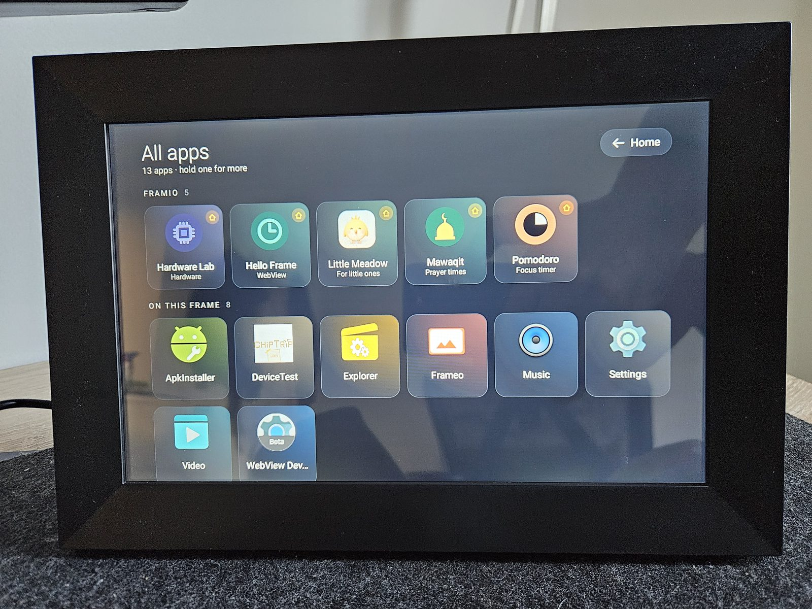</td>
    <td>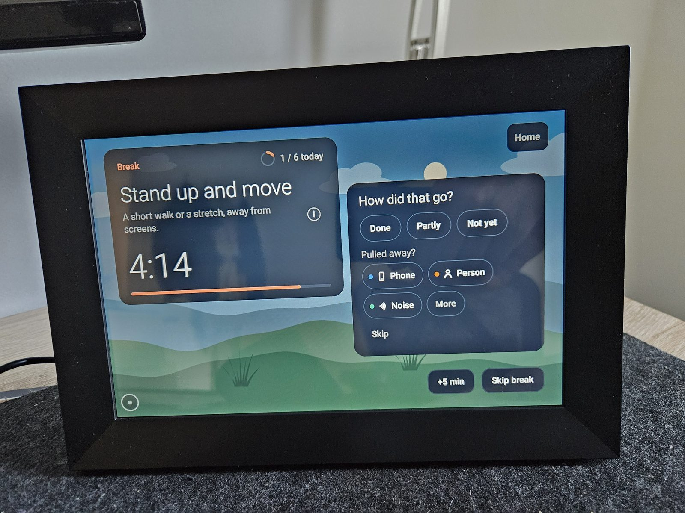</td>
  </tr>
  <tr>
    <td align="center"><sub>All apps, on the real frame</sub></td>
    <td align="center"><sub>A Pomodoro break: stand up and move</sub></td>
  </tr>
</table>

</div>

---

## Why this exists

Most screens in our lives want something from us: a like, a swipe, a notification, one more minute.
**framio is the opposite.** It is a screen that sits quietly on a shelf and does one useful thing at a time.

- **No social media.** No feeds, no accounts, no follower counts, no "trending".
- **No distraction.** No ads, no pop-ups, no badges, no red dots. Apps are calm by design and nothing leaves the frame unless you send it.
- **A productivity booster.** The frame is becoming my desk companion: a focus timer I can read from across the room, a plan for the day, and a place for the habits I want to keep.
- **Mine to extend.** Every app here is native, small, offline-first and written for this one device. There are more on the way, and **contributions are welcome** (see [Contributing](#contributing)).

## Before and now

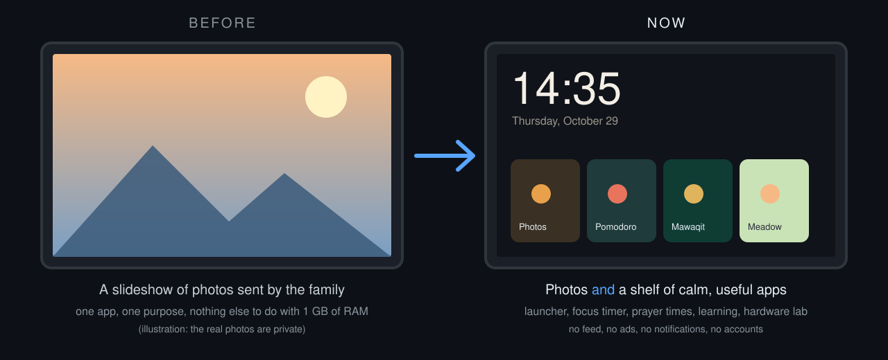

The frame shipped as a **Frameo** photo frame: relatives send pictures from a phone app and the frame plays them
as a slideshow. It does that well, and nothing else. It is also a small Android 6 computer with a good
touch screen, a speaker, a microphone and an accelerometer, sitting idle most of the day.

What we added, without removing the slideshow:

| Before | Now |
|---|---|
| Frameo is the only thing on screen | **Framio launcher** is HOME: clock, a **Photos** tile that opens Frameo, and a shelf of every installed framio app |
| No way to run anything else comfortably | Native Jetpack Compose apps, each in its own package, opened from a tile |
| Settings buried in Android's UI | **Controls** panel: volume, brightness, Wi-Fi, running apps, startup app, device info, restart / power off |
| No way to leave an app without a keyboard or remote | A movable **home-button dot** (Home · Back · Close app · Controls) |
| Updating means fiddling with adb by hand | `scripts/deploy.sh` builds and installs only what changed |
| Unknown hardware | A [Hardware Lab](#03--hardware-lab) app that tests and documents every sensor, codec and port |

The Frameo app is untouched. **Uninstall the launcher and Frameo is HOME again**
(see [Escape hatches](#escape-hatches)).

## The hardware

| | |
|---|---|
| Frame | **Veidoo F10** digital photo frame running **Frameo 1.32.12** (`net.frameo.frame`) |
| SoC | Rockchip RK312x (RK3126), 4× Cortex-A7 @ 1.0 GHz, Mali-400 (GLES 2.0) |
| Memory | 1 GB RAM, eMMC storage, SD/USB hot-plug |
| Display | 1280×800 MIPI touch panel @ 160 dpi, multi-touch (Silead gslX680), landscape and portrait following the stand |
| OS | Android 6.0.1 (API 23), **rooted** (SuperSU), WebView Chromium 107 |
| Sound and sensors | speaker, microphone, accelerometer (used for "knock to wake"), Wi-Fi |
| Not present | Bluetooth, camera, NFC, GPS, a battery-backed clock and a text-to-speech engine, which the [Hardware Lab](examples/03-hardware-lab) proves one by one |

That is a very small machine. So the rule for every app is **quality and performance first**: release builds with
R8, no heavy libraries, nothing running when the screen is off, and a test on the real frame before it ships.
Full command log with outputs: [docs/device-log.md](docs/device-log.md).

## The apps

Each app is a **standalone native app** (Kotlin and Jetpack Compose), installed over adb, opened from the launcher.
They do not depend on each other or on Frameo's photos.

| # | App | In one line | Status |
|---|---|---|---|
| 01 | [Hello Frame](examples/01-hello-frame) | Smallest possible app: a WebView clock and a JS to Kotlin bridge | working |
| 02 | [Launcher](examples/02-launcher) | The home screen: clock, tiles, controls, home-button dot | working |
| 03 | [Hardware Lab](examples/03-hardware-lab) | 15 labs that test every piece of the hardware | working |
| 04 | [Mawaqit](examples/04-mawaqit) | Mosque-style prayer times, adhan and adhkar | working |
| 04 | [Little Meadow](examples/04-little-meadow) | Calm learning for ages 2 to 5 (unplanned, may be removed) | working |
| 05 | [Hub](examples/05-hub) | A family day-ring screen | design stage, [proposal](docs/framio-hub.md) |
| 06 | [Pomodoro](examples/06-pomodoro) | A focus timer you can read across the room | working |

### 06 · Pomodoro

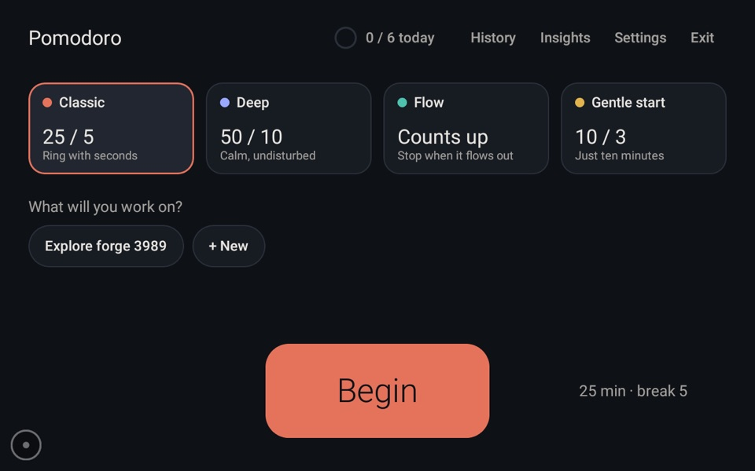 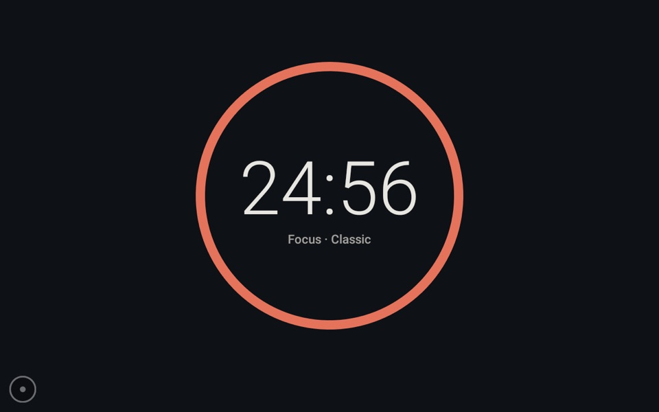

The productivity app. A calm focus timer in native Compose that works fully offline.

- **Four modes:** *Classic* (25/5), *Deep* (50/10), *Flow* (counts up, tiered breaks) and *Gentle start* (just ten minutes).
- **Deep mode** adds a start ritual, a dimmed Calm screen or backlight off through root, **knock on the case to peek**, and a **park a thought** pad so distractions get written down instead of followed.
- A slow landscape on breaks, a history of sessions with notes, and **honest insights** (no streak guilt).
- Synthesized cues and soundscapes, a built-in keyboard, nothing leaves the frame.

[Design log](examples/06-pomodoro/LOG.md)

### 04 · Mawaqit

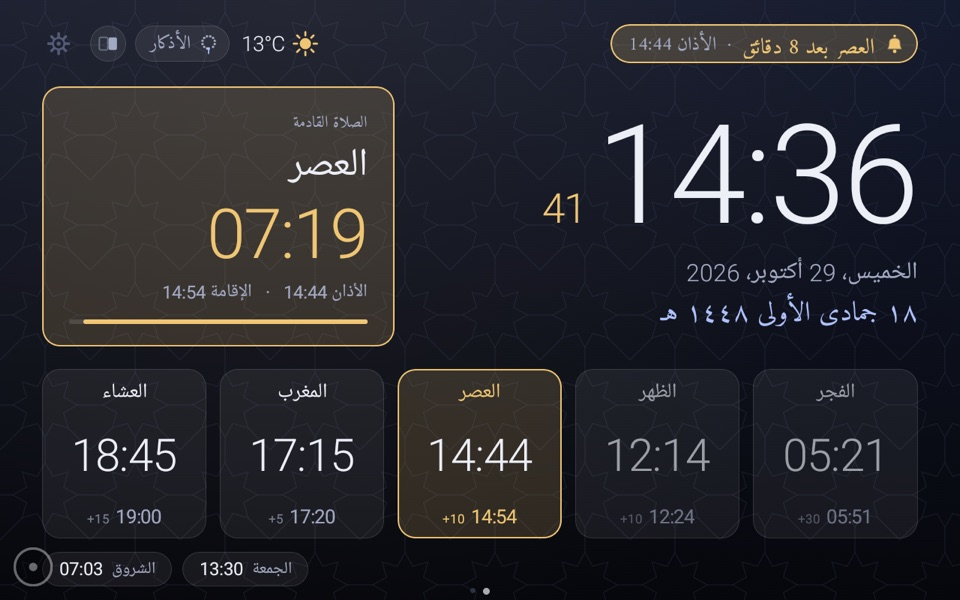 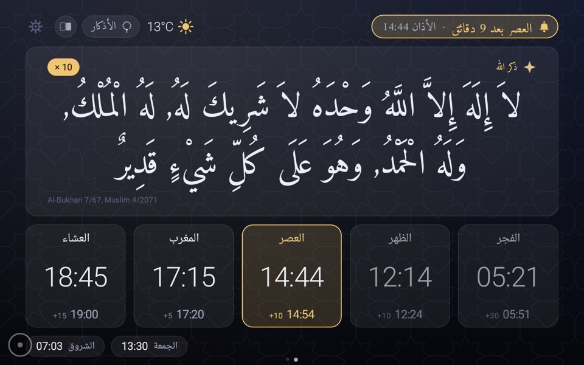

A clone of the [Mawaqit](https://mawaqit.net) mosque screen: a real mosque's timetable (no account) or times computed on the frame.

- Clock with seconds, Gregorian and Hijri date, next prayer with countdown, the five prayers with iqama.
- **Adhan on the speaker**, "adhan soon" notice, iqama countdown, Jumu'a screen, night mode that dims or turns the backlight off.
- **Adhkar** (Hisn al-Muslim): morning, evening, after-prayer and more, with a counter, streaks, a four-month heatmap and reminders.
- 5 themes, 6 languages including right-to-left Arabic.
- **Remote control:** a web panel on the LAN and an end-to-end encrypted channel through [ntfy](https://ntfy.sh).


[Full feature list](examples/04-mawaqit/README.md) · [Remote API](examples/04-mawaqit/REMOTE.md) · [LOG](examples/04-mawaqit/LOG.md)

### 04 · Little Meadow

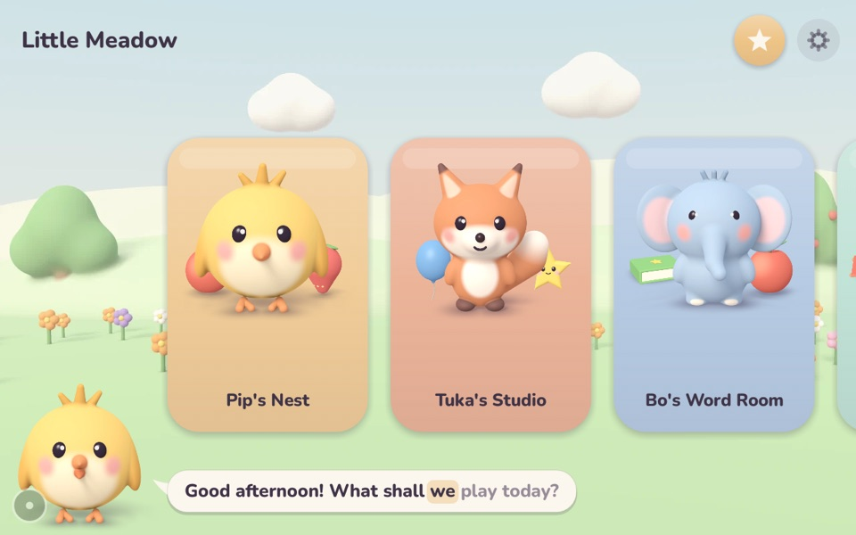

> **A happy accident.** Building a kids' game was never the plan. It just happened along the way. It may well be
> taken out again, to keep the frame for productivity and reminder apps.

A cheerful learning app for children aged 2 to 5. Five clay-style 3D friends guide **31 voice-guided activities in 7 places**:
numbers, colours and art, letters and animals, music, good habits, puzzles with real-time 3D shapes, feelings, stories and a night light.

- Adapts to the child's age and how it goes; **no timers, scores or flashing**.
- English and German, spoken and captioned word by word; a daily limit and bedtime.
- A **parent dashboard on the LAN**, including voice messages for the child.
- Original art, narration and music made on the Mac ([`tools/render3d`](examples/04-little-meadow/tools)).

[README](examples/04-little-meadow/README.md) · [DESIGN](examples/04-little-meadow/DESIGN.md) · [LOG](examples/04-little-meadow/LOG.md)

### 02 · Launcher

 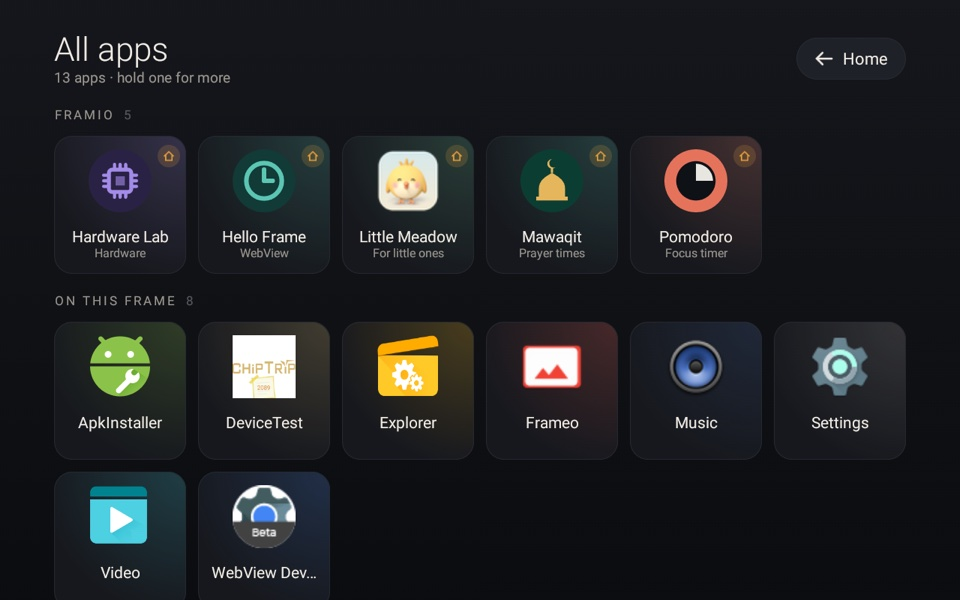

A Jetpack Compose HOME app. The firmware won't start apps in the background at boot, but it always starts HOME,
so the launcher is the one place that can bring the frame up the way you want.

- Clock, **Photos** (Frameo) and a shelf of every framio app, found automatically and styled by `dev.framio.tile.*` metadata.
- **All apps**, **Controls** (volume, brightness, Wi-Fi networks, running apps, Close all, startup app with countdown, back-after-idle, device info, restart / power off).
- A **movable home-button dot**: tap for Home · Back · Close app · Controls, hold to go home from anywhere.
- It grants itself overlay, `WRITE_SETTINGS` and Wi-Fi scan access with root. About 15 MB RAM as a release build.

[LOG](examples/02-launcher/LOG.md)

### 03 · Hardware Lab

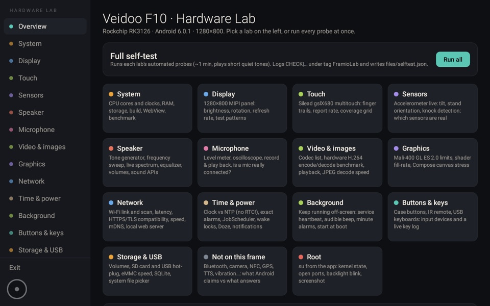

15 labs with live readouts and an automated self-test for each: system, display, touch, sensors, speaker, microphone,
video and images, graphics, network, time and power, background, buttons and keys, storage and USB, "not on this frame", and root.
It is where most of the device facts in this repo come from.

[README](examples/03-hardware-lab/README.md) · [LOG](examples/03-hardware-lab/LOG.md)

### 01 · Hello Frame

A full-screen WebView with a clock page and a `window.Frame` bridge to Kotlin. The "hello world" for getting a first app onto the frame.

### 05 · Hub (planned)

A calm family screen: a 24-hour **Day Ring** showing daylight, everyone's appointments, rain windows and running timers,
plus kitchen timers, notes and routines, dark at night and awake when you knock twice. Currently a design proposal:
[docs/framio-hub.md](docs/framio-hub.md).

## Roadmap

More apps for the same idea, a screen that helps and then gets out of the way: a daily planner, habit tracking,
a family day board (the Hub), and whatever turns out to be useful on the wall. The frame stays for **productivity and reminders**: Little Meadow was an unplanned side project and may leave. Ideas are welcome as issues.

## Contributing

**Contributions are welcome**: new apps, fixes, translations, design, docs, device notes, or just a bug report.

1. Open an issue (or a draft PR) with the idea first, so we can agree on the shape.
2. Put a new app in `examples/0N-name/` with its own package `dev.framio.<name>`. Follow the house rules:
   **standalone native** (Kotlin + Jetpack Compose), not HOME, no WebView, not tied to Frameo's photos, with an Exit control.
3. Keep it **calm and private**: no ads, no tracking, no accounts, no social features, no notifications that nag. Nothing leaves the device unless the user sends it.
4. Respect the hardware: **minSdk 23**, 1 GB RAM, Mali-400. Test a **release** build on the real frame.
5. Add a `README.md` or `LOG.md` with what you did and measured, and a screenshot (`fr shot`).
6. No private photos or secrets in screenshots, logs or backups.

Don't have a frame? Pomodoro ships screenshot tests you can run on the desktop, and any app that builds for API 23 can be reviewed from its screenshots.

## Repository layout

```
examples/   the apps (01 hello · 02 launcher · 03 lab · 04 mawaqit · 04 meadow · 05 hub · 06 pomodoro)
scripts/    deploy.sh · frame-lock.sh · backup.sh
tools/fr    Go CLI: screenshots, recordings, mirror, run, logs
docs/       device log, backup log, Hub proposal, screenshots
```

---

# Developer guide

## Set up your machine

```bash
# on the frame: Settings → About → Beta program ON → ADB access ON
brew install android-platform-tools
brew install --cask android-commandlinetools
export JAVA_HOME=$(/usr/libexec/java_home -v 21)   # JDK 17+ required, also by sdkmanager
yes | sdkmanager --licenses
sdkmanager "platforms;android-37.0" "build-tools;37.0.0"
```

Toolchain: Gradle 9.8.1 · AGP 9.4.1 (built-in Kotlin) · Kotlin 2.4.21 · compileSdk/targetSdk 37 · minSdk 23

Each example needs a `local.properties` (git-ignored):

```
sdk.dir=/opt/homebrew/share/android-commandlinetools
```

## Build, install, run

```bash
cd examples/01-hello-frame
./gradlew assembleDebug
adb install -r app/build/outputs/apk/debug/app-debug.apk
adb shell am start -n dev.framio.hello/.MainActivity
```

**On the frame:** tap **Exit** to go back to the previous screen.

### Launcher (02)

```bash
cd examples/02-launcher
./gradlew assembleRelease     # R8-minified, debug-signed: ~15 MB RAM vs ~31 MB for assembleDebug
adb install -r app/build/outputs/apk/release/app-release.apk
# no appops step since v0.2: the launcher grants itself the overlay, WRITE_SETTINGS and Wi-Fi scan access with root
# (by hand, if su is missing: adb shell appops set dev.framio.launcher SYSTEM_ALERT_WINDOW allow)
adb shell input keyevent KEYCODE_HOME   # "Select a Home app" → Framio → ALWAYS (screenshot to find the taps)
adb shell dumpsys activity activities | grep -i home   # cmp=dev.framio.launcher/.LauncherActivity
```

**On the frame:** tap a tile; tap the dot (bottom-left, movable) for Home · Back · Close app · Controls, or hold it to
go home from any app.

## Keep the frame up to date: `scripts/deploy.sh`

There is no store: every app is installed over adb and signed with the same debug key, so `adb install -r` updates it
in place and keeps its data. One script keeps the frame in step with the repo:

```bash
scripts/deploy.sh status          # per app: up to date / behind / not from here / not installed (no build)
scripts/deploy.sh                 # build every app, install only those whose APK differs from the frame's
scripts/deploy.sh launcher lab    # just these (folder name or its end: 02-launcher, launcher, hello…)
scripts/deploy.sh --no-build      # install what is already built
```

- **Variant:** release (R8, about half the RAM) when the app signs release with the debug key, else debug.
- **Changed?** md5 of the built APK vs the installed one (`pm path`). Gradle is incremental: unchanged apps build in seconds to the same bytes and are skipped.
- **Record:** each install appends `package date commit clean|dirty md5 variant` to `/data/local/tmp/framio-deploy.tsv` on the frame, so `status` can say which commit is installed and whether the app's folder changed since.
- **Safe on a shared frame:** installs run under `scripts/frame-lock.sh`; an app that was in front is reopened after its update (this firmware restarts nothing in the background).

**Rule:** after changing an app, run `scripts/deploy.sh <app>` (or plain `scripts/deploy.sh` before you stop for the
day), and check `scripts/deploy.sh status` shows no "behind". Installing by hand with `adb install` works too, but
`status` then shows the app as "not from here" until the next deploy.

## Capture and control: `fr`

[`tools/fr`](tools/fr) is one Go binary for daily work on the frame: screenshots, recordings, a
clickable mirror window, build → install → launch → logs, and tap/key control. It wraps adb, scrcpy
and ffmpeg. [README](tools/fr/README.md) · [PLAN](tools/fr/PLAN.md) · [LOG](tools/fr/LOG.md)

```bash
brew install go scrcpy ffmpeg && (cd tools/fr && go build -o ~/.local/bin/fr .) && fr doctor
fr shot                               # captures/<date>/<time>_<app>.png (git-ignored)
fr rec --time 30s --touches           # mp4; Ctrl-C stops early
fr mirror                             # live window: click = tap, drop an APK = install
fr run examples/03-hardware-lab       # build, install, launch, follow its logs
fr tap "Lab" · fr key home · fr logs dev.framio.lab --since 2m --dump
export FR_LOCK=/tmp/framio-frame.lock # when several sessions share the frame
```

## Sharing the frame

One frame, several sessions and agents: everything that changes the device (install, `am start`, taps, reboots)
takes turns through one lock, the directory `/tmp/framio-frame.lock` (`mkdir` takes it, `rmdir` releases it,
stale after 5 min). `tools/fr` (with `FR_LOCK`) and the examples' `tools/frame.sh` use it;
[`scripts/frame-lock.sh`](scripts/frame-lock.sh) adds a first-come-first-served queue, a heartbeat for long
holds, instant release of a crashed holder's lock, and an owner line others can read.

```bash
FRAME_OWNER=me scripts/frame-lock.sh run -w "install mawaqit" adb install -r app-release.apk
scripts/frame-lock.sh status          # frame: held by framio-7a · install pomodoro · 23 s · 1 waiting
FRAME_WAIT_MAX=600 scripts/frame-lock.sh run …   # give up (exit 75) instead of waiting forever
```

Keep holds short, leave the frame as you found it, and after taking the lock check the foreground app and the
installed build before trusting a screenshot: someone else may have changed them in between.

## Backup

Read-only full backup (raw partitions + `/data` archive + Frameo files, md5-verified). Keep it **outside the repo**: it contains photos and Frameo's pairing keys.

```bash
scripts/backup.sh ~/framio-backup/$(date +%F)
cd ~/framio-backup/<date> && shasum -a 256 -c SHA256SUMS   # verify
```

Partition table, commands and restore notes: [docs/backup-log.md](docs/backup-log.md) and `RESTORE.md` inside the backup folder.

## Escape hatches

Android 6 has no `pm set-home-activity` and `pm clear` keeps the "Always" choice. Uninstalling the launcher makes Frameo HOME again.

```bash
adb uninstall dev.framio.launcher          # back to Frameo as HOME (works without a reboot)
adb shell am force-stop dev.framio.hello   # close Hello Frame
adb uninstall dev.framio.hello             # remove it completely
```

## Useful commands

```bash
adb devices                                   # check the connection
adb shell su -c id                            # root shell check → uid=0(root)
adb exec-out screencap -p > screen.png        # screenshot
adb logcat -s chromium                        # WebView console.log output
adb shell dumpsys meminfo | head -45          # RAM per process
adb shell pm list packages -s                 # system apps
adb shell su -c "pm disable <pkg>"            # disable a system app (undo: pm enable <pkg>)
```

Debug the WebView from desktop Chrome: open `chrome://inspect` while the app runs.
