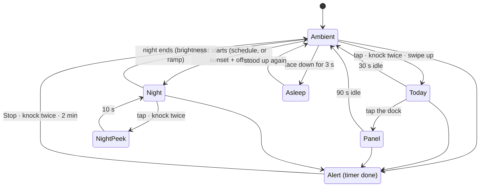
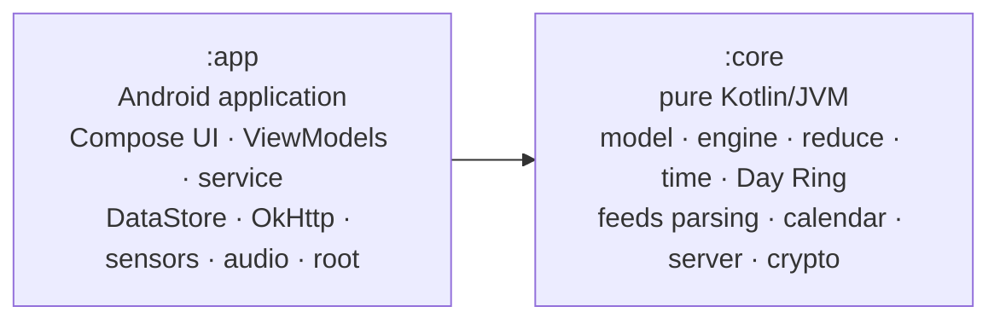

# Framio Hub: a calm family screen for the frame

> A wall clock that knows the household's day. From across the room you can see how the next 24
> hours look: daylight, everyone's appointments, when it will rain, and which timers are running. It
> also handles kitchen timers, family notes and kids' routines, goes dark at night, and wakes when you
> knock twice.

| | |
|---|---|
| Status | Design proposal v2, 2026-10-18 |
| Target | Veidoo F10: Android 6.0.1 (API 23), RK3126 4× Cortex-A7 1.0 GHz, Mali-400 GLES 2.0, 1 GB RAM, 1280×800 touch, rooted |
| Shape | **A standalone native app.** `examples/04-hub`, package `dev.framio.hub`, Kotlin + Jetpack Compose. Opened from a launcher tile or `am start`, with an Exit control. **It isn't HOME, has no WebView, and doesn't touch Frameo or its photos.** |
| Device facts | [device-log](device-log.md) · [03 Hardware Lab LOG](../examples/03-hardware-lab/LOG.md) · [02 Launcher LOG](../examples/02-launcher/LOG.md) |

## Contents

1. [TL;DR](#1-tldr)
2. [Why this idea](#2-why-this-idea)
3. [What the frame gives us](#3-what-the-frame-gives-us)
4. [Product](#4-product)
5. [Experience design](#5-experience-design)
6. [Architecture](#6-architecture)
7. [Subsystems](#7-subsystems)
8. [Performance](#8-performance)
9. [Security and privacy](#9-security-and-privacy)
10. [Build setup](#10-build-setup)
11. [Quality and testing](#11-quality-and-testing)
12. [Plan: spikes, then milestones](#12-plan-spikes-then-milestones)
13. [Operations](#13-operations)
14. [Risks](#14-risks)
15. [Later](#15-later)
16. [References](#16-references)

---

## 1. TL;DR

- **What it is.** A native app with one main screen, **Ambient**. On the left is the **Day Ring**: a
  24-hour dial showing the next 24 hours. It shows daylight, each person's events in their colour,
  rain windows, and when timers will end, with the clock in the middle. On the right is a short
  **day sentence** ("Dry until 16:00, then showers. Swimming at 17:30 · Lena."). Behind it all is a
  dark sky that follows the real sun. Tap or knock twice for **Today**. From there: **Timers**,
  **Board** (notes, checklists, finger scribbles) and **Routines**. At night the backlight goes off
  while the Hub is on screen.
- **Why this idea.** It answers the questions people really ask a kitchen screen: what's next, do I
  need an umbrella, is the pasta done. It uses the hardware that works on this frame (touch,
  speaker, accelerometer, 2.4 GHz Wi-Fi, root backlight), and needs nothing the frame lacks (mic,
  camera, Bluetooth).
- **How it's built.**
  - Two Gradle modules. `:core` is pure Kotlin/JVM and holds all behaviour: state, the reducer,
    scheduling, parsers, the Day Ring geometry, the HTTP server and the crypto. `:app` holds the
    Compose UI and thin Android adapters.
  - One-way data flow; ViewModels per screen; manual dependency injection.
  - DataStore for state; OkHttp for the network.
- **Why native, measured today.** Hello Frame, which is just a WebView, took **1.7 s to start and
  55 MB PSS**, 36 MB of it Chromium code. On Android 6 the WebView renderer runs inside the app's own
  process. The Compose launcher in a release build uses **15.6 MB**.
- **Performance.**
  - No bitmaps, and nothing animates while nothing changes. The screen redraws once a minute.
  - Release build with R8, and a Compose stability configuration.
  - Budgets that are part of every Definition of Done: ≤ 50 MB PSS, ≤ 3 % CPU when idle, ≥ 55 fps
    during transitions, ≤ 1.5 s cold start.
- **Quality.**
  - Most tests are fast JVM tests in `:core`. Compose UI tests and **screenshot tests at 1280×800**
    run on Robolectric, with Android 6 (SDK 23) as the target. HTTP code is tested against
    MockWebServer.
  - Lint with Compose rules, an API 23 guard run on the final APK, StrictMode and LeakCanary in
    debug builds.
  - On the frame: acceptance checks over adb and a 72 h soak test.
- **Plan.** Six short spikes settle the unknowns, then seven milestones. **M0 to M3 alone make a
  complete product.**

---

## 2. Why this idea

### Ideas considered

| Idea | Who it helps | Fits this frame? | Verdict |
|---|---|---|---|
| **Family hub around a Day Ring (this doc)** | the whole household, many times a day | ✅ touch, speaker, accelerometer, Wi-Fi, all verified | **chosen** |
| Home Assistant wall panel | only homes running HA | ⚠️ needs HA; dashboards in a WebView are heavy here | can be added later as a source (§15) |
| Voice assistant or intercom | everyone | ❌ the mic records a flat signal, and there is no TTS engine | impossible without new hardware |
| Video calls | remote family | ❌ no camera, no mic | impossible |
| Developer desk dashboard | one person | ✅ | too narrow for a screen in a shared room |
| Generative art or ambient visuals | nobody in particular | ✅ | kept as the sky backdrop, which carries real information (time of day, cloud) |

**The insight.** In a kitchen, the clock is the thing people look at most. It answers one question,
the time. The Hub keeps the clock's role and its calm, and makes the same two-second look also answer
"what's the rest of my day like?"

### Principles

1. **Readable in two seconds from three metres.** Everything on Ambient passes that test, or it moves
   to Today.
2. **Calm.** No badges and no attention-seeking. It makes sound only for things someone asked for, and
   respects quiet hours.
3. **Nothing to sign up for.** ICS calendar links, Open-Meteo without an API key, and phones using the
   frame's own web page. Every integration is optional.
4. **Made for hands.** Large targets, knocking, standing it on its side, laying it down. No typing on the
   frame.
5. **Honest.** Stale data is labelled ("weather 2 h old"). An unknown time shows as unknown, never as
   01:00.
6. **Light.** The Hub never makes the frame slower. Performance budgets are part of every milestone.
7. **Self-contained.** One APK that minds its own business. It changes nothing outside itself, and
   restores the backlight whenever it leaves the screen.

---

## 3. What the frame gives us

Every row was measured on this frame. "Today" means measured on 2026-10-17 or 18, while writing this
doc.

| Fact | Source | What we do about it |
|---|---|---|
| 1280×800 at 57.17 Hz, 160 dpi, so 1 dp = 1 px. No status bar or navigation bar | device-log | Design in px. A frame has 17.5 ms |
| The launcher's (02) hot corner dot sits at 16–72 px in the bottom-left corner, above every app | 02 LOG | Keep the bottom-left 88×88 px free of anything that can be tapped |
| **Hello Frame (a WebView): cold start 1667 ms, PSS 55.5 MB, of which 36 MB is Chromium code. No separate renderer process** | today: `am start -W`, `dumpsys meminfo`, `ps` | **Native Compose, not a WebView.** On Android 6 the renderer shares our process, our heap and our CPU |
| The Compose launcher in a release build: 15.6 MB PSS. Its debug build: 31 MB | 02 LOG | Measure release builds only. Budget for the Hub: ≤ 50 MB PSS |
| 4× Cortex-A7 at 1.0 GHz with core hotplug. 1 GB RAM plus 128 MB zram. Frameo uses about 150 MB while it runs. The app heap limit is 80 MB | device-log, today: `getprop` | Avoid doing work. No bitmaps in the main path. Keep allocation low so garbage collection doesn't cause stutters |
| Android 6 compiles the whole APK ahead of time at install. Baseline Profiles only apply from API 24 | ART on M | R8 and less work are what help. Startup doesn't pay a JIT warm-up |
| Mali-400 GLES 2.0, **no `highp` in fragment shaders** | 03 LOG | No custom shaders. Compose `Canvas` arcs and gradients are cheap and enough |
| A Compose animation in a **debug** build: 53 of 57 fps, 19 janks in 240 frames | 03 Display lab | Spike S1 measures a release build. Animations are short and rare |
| Accelerometer at 118.5 Hz; 03's `KnockDetector` works (1.2 m/s², 350 ms) | 03 LOG | Knock twice to wake or stop an alert. Lay it face down to sleep. Stand it in portrait for the agenda |
| The speaker works (static `AudioTrack` chime, FFT peak 991 Hz for 1 kHz). **The mic is flat and there is no TTS** | 03 LOG | Sound means short synthesized melodies. Input means touch, knocks and phones |
| **No RTC**: the clock reads 01-01 01:00 at boot until NTP. SNTP gave a 9 ms offset | device-log, 03 LOG | `TimeGate`. Timers use `elapsedRealtime` |
| The CPU never suspends (the IR driver holds a wake lock). A foreground service missed 0 heartbeats behind other apps and with the screen off | 03 LOG | A plain coroutine scheduler is reliable. No AlarmManager, WorkManager or wake locks |
| **The firmware never restarts a killed process.** Alarms, `START_STICKY` and `BOOT_COMPLETED` all get "process is bad" | 03 LOG | A standalone app runs when it's opened. A foreground service keeps it alive after Exit while it's needed (§6.4). It doesn't come back after a reboot until someone opens it |
| Wi-Fi is 2.4 GHz only, about 9 Mbps. TLS 1.2 works with 6 test hosts, including `api.open-meteo.com` and ISRG Root X1 | 03 LOG | OkHttp on the platform TLS. Let's Encrypt sites such as ntfy.sh work |
| **The frame is on the repeater's subnet (`192.168.11.x`); phones on `192.168.178.x` can't reach it** | 03 LOG | The LAN companion needs the repeater in bridge mode. Otherwise use the outbound relay (M5) |
| Root is silent for every app. SuperSU ignores multi-line `su -c` | 03 LOG, device-log | One narrow, typed `RootShell`, used only for the backlight |
| Backlight: `/sys/class/backlight/rk28_bl/brightness`, 0–255, writable as root | device-log | Night turns it off; it's restored whenever the Hub leaves the screen |
| eMMC writes at 27.6 MB/s | 03 LOG | DataStore (whole-file atomic writes) is fast enough for a few KB of state |
| **Lint's `NewApi` check misses calls newer than API 23** with Kotlin 2.4 / AGP 9.4; two real crashes came from that | 03 LOG | An API 23 guard on the final APK is part of `check` (§11) |
| Library minSdk read from the AAR manifests today: Compose BOM 2026.09.00, lifecycle 2.11.0, DataStore 1.2.1 → 23; OkHttp 5.5.0 → 21 | today | The dependency set below is safe for Android 6. Re-check whenever a version changes |
| Time zone `Europe/Amsterdam`, locale `en-US` | today: `getprop` | English and German strings. Formats follow the locale and its 24 h setting |

---

## 4. Product

### Who it is for

- **The household**: 2–5 people, adults and children, with the frame in the kitchen or living room,
  seen from 1–3 m while cooking, eating or passing by.
- **The person who runs it** (you): sets it up once from a phone or adb, and has logs, adb commands
  and a self-test when something goes wrong.

### Jobs it does

| When… | I want… | Feature |
|---|---|---|
| I pass by | to see how the day looks at a glance | Day Ring and the day sentence |
| I'm about to leave | to know whether I need an umbrella | The rain window on the ring and "Rain from 08:15" |
| I'm cooking | 2–3 timers I can tell apart without looking | Named timers, each with its own colour and melody |
| a timer goes off and my hands are dirty | to stop it without touching the screen | Knock twice |
| the kids need to get ready | them to follow their routine by themselves | Routines: icon checklists with a visual countdown |
| I leave a message | something like a fridge note | Board: typed notes from a phone, scribbles on the frame |
| I'm at the store | the shopping list | Board checklists on the phone web page (LAN, or the relay in M5) |
| it's night | darkness | Backlight off on a schedule; a tap shows a dim clock |

### Features by milestone

| Milestone | Delivers |
|---|---|
| **M0 Foundation** | Modules, build setup, engine (commands, reducer, store), app shell, service policy, logging, adb control, quality gates |
| **M1 Ambient** | Day Ring, sky, clock with `TimeGate`, day sentence (time and timers), night with the backlight, knock and stand detection |
| **M2 Today** | Weather and rain nowcast, ICS calendars with a colour per person, Today and Week views, the full day sentence, staleness labels |
| **M3 Family** | Timers with the dial, the Alert screen and melodies; Board (notes, checklists, scribbles); Routines |
| **M4 Phones on LAN** | Pairing with QR and PIN, a phone web page served by the Hub, HTTP API, live updates |
| **M5 Remote** | ntfy relay with AES-GCM end-to-end encryption; the same web page hosted on HTTPS |
| **M6 Polish** | Portrait agenda mode, optional animated weather, an optional hourly chime, Diagnostics with self-test, German strings, 72 h soak |

### Non-goals

- **No photos.** Frameo stays the photo app, and the Hub never reads its files or starts it.
- No HOME role. The launcher stays HOME and opens the Hub like any other app.
- No creating calendar events on the frame. You create them in your calendar app and they appear here.
- No voice, video or camera features.
- No accounts, telemetry or ads. Nothing leaves the frame except weather and ICS requests and the
  optional relay.

---

## 5. Experience design

### 5.1 Modes



- **Modes only apply while the Hub is on screen.** When the Hub leaves the screen (Exit, or another
  app comes to the front), it restores the backlight and stops listening to the accelerometer.
- **An Alert interrupts everything, including other apps.** The foreground service brings the Hub to
  the front (Android 6 allows starting an activity from a foreground service) and starts the sound
  immediately, without waiting for the UI.
- The rules above live in a pure `ModeMachine` in `:core` and are unit-tested, including idle timeouts
  run on a virtual clock.

### 5.2 Ambient and the Day Ring

```
x 0                                 720                                     1280
┌──────────────────────────────────────────────────────────────────────────────┐ y 0
│                12:00                         Saturday 17 October             │
│          ╭─────────●─────────╮                                               │
│      ╭───  ░░ daylight arc ░░  ───╮          Dry until 16:00,                │ ← day sentence,
│     ╱  ▬▬ Football · Max            ╲        then showers.                   │   44 px Light,
│    │                                 │       Swimming at 17:30 · Lena.       │   ≤ 3 lines
│06:00            07:42            18:00                                       │
│    │      (clock 132 px Light)       │       ☁ 12°    ↑15° ↓8°               │ ← 64 px
│     ╲  ┄┄┄ rain 16:00–19:00 ┄┄┄     ╱                                        │
│      ╰───   ▬ Swimming · Lena   ───╯         ◔ Pasta 4:32   ✎ 1 new          │ ← chips
│          ╰─────────○─────────╯                                               │
│ ●              00:00                                                         │
└──────────────────────────────────────────────────────────────────────────────┘ y 800
  ↑ the launcher's dot: the bottom-left 88×88 stays empty
```

**How the ring works.** It is a 24-hour dial with **00:00 at the bottom and 12:00 at the top**, so the
daylight arc sits on top like the sun's path, with sunrise on the left and sunset on the right. It
**always shows the next 24 hours**. The **now marker** sweeps clockwise. Anything just *behind* the
marker is **tomorrow** and is drawn at 50 % with a dashed edge. At 21:00 you can already see tomorrow's
08:00 dentist appointment.

| Element | Radius (px) | Look | Source |
|---|---|---|---|
| Track: night and daylight | 300, stroke 28 | `Surface2` at night; daylight in `Amber` at 35 %; twilight as a `Brush.sweepGradient` between them | `Sun` (computed locally) |
| Events | lanes at 334, 352, 370, stroke 14 | One arc per event in the person's colour; overlaps move to the next lane; a 4th overlap becomes "+n" | ICS feeds |
| Rain | 268, dotted | `Sky` dots wherever precipitation is ≥ 0.2 mm/h or probability ≥ 50 % | Open-Meteo `minutely_15` and hourly |
| Timers | inside 286 | A small triangle where each timer ends, in the timer's colour | engine state |
| Now | 300 | Bright `Ink` dot with a short notch; the past hour fades out behind it | clock |
| Clock | centre | 132 px Light, tabular digits (`tnum`) | `TimeGate` |

The angle of time `t` (minutes since midnight), in Canvas degrees (0° = 3 o'clock, clockwise), is
`θ = 90° + t / 1440 × 360°`. All geometry (angles, lanes, overlaps, the tomorrow cut-off) is computed by
a pure `DayRingModel` in `:core` and tested. The Compose layer only draws what it's given.

**Right column** (x 720–1240):
- the date, 32 px, `InkDim`;
- the **day sentence**, 44 px Light, at most 3 lines (§7.9);
- the weather: 64 px temperature, icon, high and low;
- up to 3 **chips**: running timers with mm:ss, new notes, routine progress.

**Sky backdrop.** A vertical gradient chosen by the sun's elevation and the cloud cover (§5.8). It
changes at most once every 5 minutes, with a 2 s crossfade. Every colour is dark enough that `Ink` text
on it stays at **≥ 7:1 contrast**, and a unit test checks every colour stop.

### 5.3 Today

```
┌──────────────────────────────────────────────────────────────────────────────┐
│ 07:42   Saturday 17 October                               ☁ 12°   ↑15° ↓8°   │
│──────────────────────────────────────────────────────────────────────────────│
│ TODAY                                  │ NEXT 12 HOURS                        │
│ ▌09:00  Football             Max       │ ▁▂▅▇▅▂▁▁▁▁▁▁  rain 16:00–19:00       │
│ ▌17:30  Swimming             Lena      │ 12°  13°  15°  15°  14°  12°         │
│ TOMORROW                               │ TIMERS   ◔ Pasta 4:32   ◑ Oven 18:10 │
│ ▌all day  Grandma's birthday           │ BOARD    "Milk + eggs" · Sam (2 h)   │
│ ▌08:00  Dentist              Sam       │ ROUTINE  Lena · Bedtime 3/5           │
│──────────────────────────────────────────────────────────────────────────────│
│ ●   Today   Timers   Board   Routines                      Settings   Exit   │ ← dock, 96 px
└──────────────────────────────────────────────────────────────────────────────┘
```

**Exit** is always in the dock, like the escape hatch in the other examples. A **long press on Exit**
quits completely (§6.4). **Settings opens with a 3 s hold**, which keeps children out without a PIN.

### 5.4 Panels

| Panel | Contents | Interactions |
|---|---|---|
| **Today / Week** | A day list, or a 7-column week (≈ 176 px per column) with a colour bar per person | Read-only. Tap an event for its location and notes |
| **Timers** | Preset grid (1, 3, 5, 10, 15, 20, 30, 45, 60 min); label chips (Pasta, Eggs, Oven, Tea, Laundry, Homework); running timers as big shrinking discs, like a Time Timer | **Drag around a dial** to set minutes, no keyboard. Tap a disc to pause, add 1 min, or stop |
| **Board** | Notes in a grid: text (from phones), checklists, scribbles | Tick checklist items. **New scribble**: a full-screen canvas with 4 inks and an eraser, saved as vector strokes. Expiry: today, 3 days, or pinned |
| **Routines** | One column per child: big icon steps, a progress star, an optional "leave in 10 min" disc | Tap a step to tick it (soft click and glow). Finishing a routine plays a short melody |
| **Settings** | Night schedule, brightness, sound and quiet hours, motion, location, people, calendars (set up from a phone), Add phone, Remote access, Keep running after Exit, Diagnostics, About (Open-Meteo credit) | Long holds for anything that can't be undone |

### 5.5 Alert (timer done)

- The whole screen fills with the timer's colour. The label is 96 px. There is a **Stop** button
  (320×160) and two smaller ones, **+1 min** and **+5 min**.
- The timer's melody repeats every 4 s and gets louder, from 40 % to 100 % over 30 s.
- **Knocking twice stops it.**
- After 2 minutes it goes quiet, and a chip ("Pasta finished 2 min ago") stays until someone touches the
  screen.
- If several timers finish together they stack, and each Stop affects only the one on top.

### 5.6 Night (only while the Hub is on screen)

- The backlight turns off through root sysfs at the scheduled time, or at sunset + X. The panel stays
  on, so touch should still work; spike S2 confirms this.
- A tap or two knocks shows the **night clock** for 10 s: large digits in `Amber` at 30 % on black, at
  minimum brightness. Then the screen goes dark again.
- Before wake-up time, brightness ramps from off to the day level over 15 minutes.
- The night clock moves by up to ±8 px each minute so the LCD doesn't keep a ghost image.
- **Leaving the Hub always restores the backlight first**: in `onStop`, on Exit, in the crash handler,
  and again at the next start.

### 5.7 Physical interactions

| Gesture | How it's detected | What it does |
|---|---|---|
| Tap | touch | Ambient → Today; Night → night clock |
| Swipe up or down on Ambient | touch | Today / back |
| **Knock twice** on the edge or back | accelerometer: 2 spikes 120–600 ms apart, quiet before and after (§7.5) | Wake, open Today, **stop a ringing alert** |
| **Stand it in portrait** | stand reading stable for 2 s | Portrait agenda layout (M6) |
| **Lay it face down** | face down for 3 s | Asleep: backlight off, everything muted except alerts |
| Volume keys, *if the case has them* | `KeyEvent` (`rk29-keypad` reports them; the case isn't checked yet) | Alert volume, or snooze |
| IR remote, *if a receiver exists* | `KeyEvent` D-pad | Move between panels (M6, once a receiver is confirmed with 03's Keys lab) |

### 5.8 Visual language

**Design system.** Built on `compose.foundation`, with our own tokens and components and no Material.
The UI is made for a 10" screen read from across a room, which Material's phone-scale components don't
suit, and leaving Material out keeps the APK and memory small. Tokens are provided through
`CompositionLocal`s. The colour names match 02 and 03, so the examples look like one family.

| Token | Value | Use |
|---|---|---|
| `Surface0` / `Surface1` / `Surface2` | `#0E0F12` / `#16181D` / `#1E2127` | Panels, cards, the night track |
| `Ink` / `InkDim` / `InkFaint` | `#F1ECE4` / `#9A968E` / `#55575D` | Text. Warm white is easier on the eyes at night |
| `Amber` | `#E9A23B` | Reserved for the sun, daylight and the night clock |
| Person and timer colours | `Teal #5BC6B4`, `Coral #E5735C`, `Sky #6AA8E8`, `Violet #A38BE8`, `Lime #A8CF5A`, `Rose #E07AA6` | Always shown with a name or initials, never colour alone |

**Sky** (top → bottom; all have relative luminance ≤ 0.07, so `Ink` stays at ≥ 7:1):

| Sun elevation | Top | Bottom |
|---|---|---|
| Night (< −12°) | `#0B1020` | `#141A2A` |
| Blue hour (−12° … −4°) | `#16213A` | `#2A2440` |
| Golden hour (−4° … +6°) | `#2B2A44` | `#4A3326` |
| Day (> +6°) | `#1E3550` | `#2C4A63` |
| Overcast (cloud cover > 70 %), replaces Day | `#2A3038` | `#343B44` |

**Type.** System Roboto, so no font file is loaded. Weights are reached through *named* families
(`sans-serif-light`, `sans-serif-medium`): below API 28, Compose only maps weights that way (found by 02).
Clocks set `fontFeatureSettings = "tnum"` so the digits don't shift as they change.

| Role | Size | Readable from |
|---|---|---|
| Ring clock | 132 px Light | ~5 m |
| Big numbers (temperature, Alert label) | 64–96 px Light | ~4 m |
| Day sentence | 44 px Light | ~3 m |
| Chips, Today rows | 32 px | ~2 m |
| Body | 26 px | arm's length |
| Captions | 20 px, never smaller | arm's length |

**Touch targets** are at least 72 px, bigger than Material's 48 dp, because people stand, reach and have
wet hands. Main actions are at least 160 px.

**Motion.** Panels fade and slide 24 px in 220 ms with `FastOutSlowIn`. The sky crossfades in 2 s.
Timer discs move once a second. No springs and no overshoot. **Reduce motion** keeps only fades.

### 5.9 Sound

- **Synthesized, with no audio files.** A pure `MelodySynth` in `:core` renders 16-bit PCM, inspired by
  03's `Synth`/`Chime`, which proved that a static `AudioTrack` plays to the last frame here.
- **Each timer has its own melody**, taken from a pentatonic set so that two timers ringing at once still
  sound pleasant. People learn which melody is which.
- Alerts use `USAGE_ALARM`, so they follow the alarm volume. Board and routine sounds use `USAGE_MEDIA`
  at −18 dB. The Hub never changes system volumes.
- Quiet hours (default 21:30–07:00) mute everything except alerts.
- **The speaker shakes the frame.** While a sound is playing, the knock detector raises its threshold by
  the amount spike S4 measures.

### 5.10 Accessibility and copy

- Contrast ≥ 7:1 on the sky and ≥ 4.5:1 everywhere else. Colour never carries meaning on its own.
- Every interactive element has semantics (role and label). That also makes the UI tests robust.
- English and German resources. Plurals use `<plurals>`. Times use `DateFormat.is24HourFormat`.
- Plain, warm wording: "Rain from 08:15", "Dry until tonight", "Weather is 2 h old". Error details go to
  Diagnostics, not to the main screen.

---

## 6. Architecture

### 6.1 Rules the architecture follows

1. **One-way data flow.** Inputs become `Command`s, a pure `reduce` turns them into new state and
   effects, and the UI renders state. Nothing else changes state.
2. **The logic lives in pure Kotlin.** Everything that decides anything is in `:core`, which has no
   Android dependency. The compiler enforces this, because it's a JVM module. All of it is tested on the
   JVM in seconds.
3. **Adapters at the edges.** Android APIs (sensors, audio, root, DataStore, OkHttp) sit behind small
   interfaces defined in `:core` and implemented in `:app`.
4. **One source of truth per kind of data.** *Owned* state (timers, notes, routines, settings) belongs
   to the engine and DataStore. *Derived* data (weather, agenda) belongs to the feed repository and its
   cache. Each screen combines them in a pure model builder.
5. **Structured concurrency.** Each scope has an owner (the app, the service, a ViewModel). Nothing is
   launched without an owner, and every network call has a timeout.
6. **Failures stay contained.** A failing source produces stale data, never a crash. A crash loop leads to
   safe mode, not a dead screen.

### 6.2 Modules



- **Why two modules and not more?** Two is enough to enforce the one rule that matters: no Android in
  the logic. One module per feature would add build configuration and slow builds, and gain nothing for
  a single developer and a single app. Feature boundaries are packages inside `:app`.
- **Testing support**: `:core` uses the `java-test-fixtures` plugin, so fakes such as `FakeClock`,
  `InMemoryStateStore` and test-data builders are shared with `:app`'s tests.
- **In `:core`, prefer the Kotlin standard library over `java.*`.** The JVM compiler doesn't know what
  Android 6 lacks. Allowed: `java.time` (desugared), `java.net` sockets, `javax.crypto`. The API 23
  guard on the final APK catches mistakes (§11).

### 6.3 Runtime overview

```mermaid
flowchart LR
    subgraph Inputs
        UI[Compose UI<br/>actions]
        LAN[HttpServer<br/>phones on Wi-Fi]
        RELAY[RelayClient<br/>ntfy · E2E]
        ADB[adb intents]
        SENS[Accelerometer<br/>knock · stand]
        SCHED[Scheduler<br/>ticks]
    end
    subgraph Core[":core — pure"]
        ENGINE((HubEngine<br/>single-writer inbox))
        RED[reduce&#40;state, input, now&#41;]
        STATE[(HubState<br/>StateFlow)]
    end
    subgraph Derived["Derived data"]
        FEEDS[FeedRepository<br/>Open-Meteo · ICS]
        TIME[TimeGate<br/>SNTP]
    end
    subgraph Adapters[":app adapters"]
        STORE[DataStore]
        SOUND[SoundEngine]
        POWER[DisplayPower<br/>window · RootShell]
        NAV[AlertLauncher]
    end
    UI & LAN & RELAY & ADB & SENS & SCHED --> ENGINE --> RED --> STATE
    RED -- effects --> SOUND & POWER & NAV
    STATE -- conflated writes --> STORE
    STATE --> VM[ViewModels] --> UI
    FEEDS & TIME --> VM
    FEEDS & TIME --> SCHED
```



### 6.4 Lifecycle as a standalone app

| Component | Role |
|---|---|
| `HubActivity` | The only activity. `MAIN`/`LAUNCHER`, `singleTask` (adb extras arrive through `onNewIntent`), `FLAG_KEEP_SCREEN_ON`, handles `configChanges` itself (rotating on a Cortex-A7 is too expensive to recreate the activity). The window background is `Surface0`, so there's no white flash on cold start |
| `HubService` | Foreground service with no logic. It only keeps the process at foreground priority while the Hub is needed off screen. Declares `foregroundServiceType="specialUse"` for targetSdk 37; Android 6 ignores the type |
| `HubApplication` | Creates the `AppContainer` (manual dependency injection): engine, stores, repositories, clients. Everything is lazy, so nothing extra runs at startup |

**When the service runs:**

| Situation | Service | Why |
|---|---|---|
| Hub on screen | running | Scheduler, LAN server, relay |
| Hub left (Exit or another app), a timer running or ringing | running | **Timers must ring**, and the Alert brings the Hub back to the front |
| Hub left, no timers, **Keep running after Exit** on (the default) | running | Phones can still reach the board and timers |
| Hub left, no timers, that setting off | stops | A standalone app shouldn't stay around. Android may then reclaim the process |
| **Long press on Exit** ("Quit") | stops after a confirmation if timers are running | A complete stop |
| After a reboot | not running until someone opens it | The firmware blocks background starts (03 LOG). Documented, not worked around |

The accelerometer and backlight control follow the **activity's visibility**, not the service. They run
only while the Hub is on screen. That saves CPU, and the Hub never controls the screen behind another
app's back.

### 6.5 Engine (in `:core`)

```kotlin
/** Commands anyone may send: the UI, phones (LAN or relay) and adb. The same JSON everywhere. */
@Serializable
sealed interface Command {
    val id: String   // chosen by the sender (UUID); duplicates are dropped, because the relay delivers at least once
    val from: String // "frame", "lan:<device>", "relay:<device>", "adb"
}

@Serializable @SerialName("timer.start")
data class TimerStart(override val id: String, override val from: String, val label: String, val ms: Long) : Command

/** What reduce() sees: wire commands plus events only the frame itself produces. */
sealed interface Input {
    data class Wire(val command: Command) : Input
    data object Tick : Input
    data class Knock(val count: Int) : Input
    data class Stand(val stand: StandKind) : Input
    data class TimeTrusted(val offsetMs: Long) : Input
}

/** Pure: no I/O, no Android. The hub's behaviour is tested through this one function. */
fun reduce(state: HubState, input: Input, now: Now): Next

data class Now(val elapsedMs: Long, val bootId: String, val wallMs: Long?, val zone: ZoneId) // wallMs is null until TimeGate trusts the clock
data class Next(val state: HubState, val effects: List<Effect> = emptyList())

sealed interface Effect {
    data class Play(val melody: Int, val loop: Boolean) : Effect
    data object StopSound : Effect
    data class Backlight(val level: BacklightLevel) : Effect
    data class ShowAlert(val timerId: String) : Effect
    data class Publish(val rev: Long) : Effect // tell SSE listeners and the relay that state changed
}

/** One coroutine applies inputs in order: no locks, no races between a finger and a phone. */
class HubEngine(private val clock: HubClock, private val store: StateStore, private val effects: EffectHandler, scope: CoroutineScope) {
    private val inbox = Channel<Input>(capacity = 64)
    private val _state = MutableStateFlow(HubState())
    val state: StateFlow<HubState> = _state.asStateFlow()

    fun dispatch(input: Input): Boolean = inbox.trySend(input).isSuccess

    init {
        scope.launch {
            _state.value = store.load()
            for (input in inbox) {
                val next = reduce(_state.value, input, clock.now())
                if (next.state != _state.value) {
                    _state.value = next.state // the UI updates at once
                    store.offer(next.state)   // a conflated writer persists the latest state, off the inbox
                }
                next.effects.forEach { effects.handle(it) }
            }
        }
    }
}
```

The frame's own UI sends commands through the same `dispatch`. So anything you can do by touch can
also be tested from the JVM and driven from adb.

### 6.6 State

```kotlin
@Serializable
data class HubState(
    val schema: Int = 1,               // bumped together with a migration function and a fixture test
    val rev: Long = 0,                 // +1 on every change; phones sync on it
    val timers: List<Timer> = emptyList(),
    val notes: List<Note> = emptyList(),
    val routines: List<Routine> = emptyList(),
    val people: List<Person> = emptyList(),
    val settings: Settings = Settings(),
    val seen: List<String> = emptyList(), // last 256 command ids, for dropping duplicates
)

@Serializable
data class Timer(val id: String, val label: String, val totalMs: Long, val melody: Int, val color: Int, val run: Run)

@Serializable
sealed interface Run {
    @Serializable data class Running(val until: Deadline) : Run
    @Serializable data class Paused(val remainingMs: Long) : Run
    @Serializable data class Ringing(val since: Deadline) : Run
}

/** Survives the process dying (same boot) and, once the time is trusted, a reboot. */
@Serializable
data class Deadline(val bootId: String, val elapsedMs: Long, val wallMs: Long?)

@Serializable
data class Note(val id: String, val author: String?, val body: NoteBody, val createdWallMs: Long?, val expiresWallMs: Long?, val pinned: Boolean)

@Serializable
sealed interface NoteBody {
    @Serializable data class Text(val text: String) : NoteBody
    @Serializable data class Checklist(val title: String, val items: List<Item>) : NoteBody
    /** The strokes live in files/scribbles/<id>.bin (see ScribbleCodec), so state stays a few KB. */
    @Serializable data class Scribble(val fileId: String, val strokeCount: Int) : NoteBody
}

@Serializable
data class Routine(val id: String, val personId: String?, val title: String, val steps: List<Step>, val resetAt: String = "04:00", val lastResetDay: String? = null)
```

- **Owned state**: `HubState`, persisted by **DataStore** (§6.8).
- **Secrets**: ICS URLs and the relay key, kept in a *separate* DataStore that is never exported and
  never logged.
- **Derived data**: the weather and agenda snapshot, held by `FeedRepository`, with its last good parsed
  copy in `cacheDir/today.json`, so the first frame after a start shows real data even without network.

### 6.7 UI layer

- **One ViewModel per screen** (`AmbientViewModel`, `TodayViewModel`, `TimersViewModel`,
  `BoardViewModel`, `RoutinesViewModel`, `SettingsViewModel`), plus `ShellViewModel` for the mode,
  the dock, idle timeouts and the alert. ViewModels are created through `viewModelFactory { initializer { … } }`
  from the `AppContainer`.
- **State out, actions in.**

```kotlin
class AmbientViewModel(engine: HubEngine, feeds: FeedRepository, time: TimeSource) : ViewModel() {
    val uiState: StateFlow<AmbientUiState> =
        combine(engine.state, feeds.today, time.minutes) { s, f, now -> AmbientUiState.from(s, f, now) }
            .stateIn(viewModelScope, SharingStarted.WhileSubscribed(5_000), AmbientUiState.Loading)
}

@Composable
fun AmbientRoute(vm: AmbientViewModel = viewModel(factory = AmbientViewModel.Factory)) {
    val state by vm.uiState.collectAsStateWithLifecycle()
    AmbientScreen(state, onAction = vm::onAction)
}

@Composable
fun AmbientScreen(state: AmbientUiState, onAction: (AmbientAction) -> Unit) { /* stateless: previews + screenshot tests */ }
```

- `…UiState.from(...)` delegates to pure builders in `:core` (`DayRingModel`, `GlanceRanker`), so the
  ViewModel stays thin.
- **Navigation is a state machine, not a navigation library.** There are six destinations, an
  always-on screen, and returns on idle timeouts. `ModeMachine` in `:core` decides, and `HubShell`
  renders the current mode with `AnimatedContent`. There's no back stack to get wrong, and the frame
  has no Back key anyway.
- **Stability.** `:core` classes come from a module without the Compose compiler. A
  `compose_stability.conf` marks `dev.framio.hub.core.**` and `kotlin.collections.*` as stable, so
  Compose compares them with `equals` and skips unchanged parts (§8).

### 6.8 Data layer

| Store | Technology | Why |
|---|---|---|
| Owned state | **DataStore 1.2.1** with a kotlinx-serialization JSON `Serializer<HubState>` | Atomic whole-file writes, a `Flow` API, a single writer, and a `ReplaceFileCorruptionHandler`. Right-sized for a few KB. Room (relational queries and migrations) isn't needed |
| Secrets | A second DataStore | Kept apart from export and debug dumps |
| Scribbles | `files/scribbles/<id>.bin` via `AtomicFile` | Binary, delta-encoded varints of points quantized to 0..4095; 2–8 KB each |
| HTTP | **OkHttp 5.5.0** with a 10 MB `Cache` | `ETag` and `If-Modified-Since` for free, connection pooling, timeouts, interceptors. Tests use MockWebServer |
| Parsed feeds | `cacheDir/today.json` | The first frame has data before any network request |

- **Writes.** The engine's in-memory `StateFlow` is updated first, so the UI never waits for the disk. A
  writer coroutine collects `state.conflate()` and calls `dataStore.updateData`. Ten quick taps cause at
  most two writes.
- **Corrupt state.** The corruption handler copies the bad file to `state.bad-<ts>.json`, then starts
  from defaults. Nothing is lost silently.
- **Schema.** `HubState.schema` and `migrate(json: JsonObject)` live in `:core`, with fixture files of
  every past version in the tests.
- **Secrets at rest.** Encrypting secrets with the Android Keystore was considered and left out: every
  app on this frame gets root silently, so encryption at rest adds complexity without protecting anything
  (§9).

### 6.9 Threading

| Work | Where |
|---|---|
| Compose | main thread: no disk, network or parsing (enforced by StrictMode in debug builds) |
| Engine inbox | `Dispatchers.Default.limitedParallelism(1)` |
| Network and disk | `Dispatchers.IO` |
| ICS expansion | `Dispatchers.Default` (CPU-bound; the result is cached) |
| Accelerometer | a `HandlerThread` passed to `registerListener` |
| HTTP server | 1 thread accepting connections plus a pool of 4 workers; at most 4 SSE streams |

### 6.10 Startup

1. `HubApplication.onCreate`: only the container, lazily. StrictMode in debug builds.
2. `HubActivity.onCreate`: `setContent` with the cached `today.json` and the stored state. **The first
   frame comes without any network.** Target: `am start -W` `TotalTime` ≤ 1.5 s.
3. The service starts (foreground), then the scheduler, then `TimeGate` (SNTP as soon as Wi-Fi is up).
4. After the first frame has drawn (`reportFullyDrawn` once the ring is drawn): feeds refresh, then the
   LAN server and relay start.

### 6.11 Code layout

```
examples/04-hub/
  settings.gradle.kts  build.gradle.kts  gradle.properties  gradle/libs.versions.toml
  compose_stability.conf
  core/                          pure Kotlin/JVM: no Android, no AndroidX
    src/main/kotlin/dev/framio/hub/core/
      model/     HubState Timer Note Routine Person Settings Ids
      engine/    Command Input Effect Reduce HubEngine StateStore HubClock EffectHandler
      time/      TimeGate Sntp Sun Schedules
      day/       DayRingModel GlanceRanker Sentence ModeMachine
      feeds/     OpenMeteo Ics Agenda RefreshPolicy
      timers/    TimerMath MelodySynth
      sensors/   KnockPattern StandFilter
      board/     ScribbleCodec Expiry
      net/       HttpServer Router Pairing Envelope RelayProtocol
    src/test/kotlin/…  src/test/resources/{ics,openmeteo,accel,state}/
    src/testFixtures/kotlin/…  FakeClock InMemoryStateStore builders
  app/
    src/main/kotlin/dev/framio/hub/
      HubApplication.kt  HubActivity.kt  di/AppContainer.kt
      service/   HubService AlertLauncher ServicePolicy
      data/      HubStateStore SecretsStore FeedRepository HttpClients ScribbleFiles
      platform/  Accelerometer SoundEngine DisplayPower RootShell BootId Logs
      ui/
        designsystem/  Theme Tokens Type Icons components/
        shell/         HubShell ShellViewModel Dock
        ambient/       AmbientRoute AmbientScreen DayRing Sky AmbientViewModel
        today/ timers/ board/ routines/ settings/ alert/ night/
      debug/     AdbCommands SelfTest
    src/main/assets/web/        phone companion: index.html app.js app.css (vanilla, no build step)
    src/test/kotlin/…           Robolectric: Compose UI tests, Roborazzi screenshots, adapters
    src/test/screenshots/       golden PNGs (1280×800)
  tools/api23_check.py  scripts/soak.sh  README.md  LOG.md
```

---

## 7. Subsystems

### 7.1 Drawing the Day Ring and the sky

- `DayRing` is one `Canvas` using `Modifier.drawWithCache`. Paths, brushes and measured text are built
  **only when the `DayRingModel` changes**: once a minute, or when events, weather or timers change.
  Each draw then only replays about 50 arcs.
- The now marker moves once a minute. There is no per-frame animation on Ambient.
- Text is measured with a remembered `TextMeasurer` and drawn with `drawText`, with no new
  layout passes.
- The sky is a `drawBehind` with `Brush.verticalGradient`. A phase change crossfades with
  `animateColorAsState` over 2 s. Its value is **read in the draw phase**, so the crossfade never
  recomposes.
- Optional animated weather (M6): rain streaks and drifting clouds, on only if the frame-rate governor
  allows it. The governor uses `FrameStats` (03) on panel transitions. If more than 3 frames miss vsync
  in a transition, three times in a row, it turns animation off for good and logs `EVENT|perf|…`.

### 7.2 Time and scheduling

- **`TimeGate`**: `Unknown` or `Trusted(offsetMs)`.
  - Until the time is trusted, the clock shows `--:--` with "Waiting for the time". The ring, the
    agenda, routines and the night schedule are paused. Timers keep running, because they use
    `elapsedRealtime`.
  - Once our own SNTP answer arrives, the UI shows `currentTimeMillis() + offset`, even before Android
    has corrected its own clock.
  - The time becomes trusted on the first of: our SNTP answer, `ACTION_TIME_CHANGED` with a plausible
    year, or an HTTPS `Date` header.
- **One scheduler.** A single coroutine computes the next wake-up as the earliest of:
  - a timer deadline;
  - the next minute boundary (only while the clock is on screen);
  - a night or day change;
  - a routine reset;
  - the next feed refresh.

  It waits with `delay`, then sends `Tick`. Dynamic receivers for `TIME_CHANGED`, `TIMEZONE_CHANGED`
  and `SCREEN_ON` make it recompute.
- **No AlarmManager, JobScheduler or WorkManager.** The CPU never sleeps, they can't restart a dead
  process on this firmware, and the JobScheduler test showed 4.1 s of lateness.
- **Sun**: the NOAA solar-position algorithm runs on our coordinates, so sunrise, sunset and the sun's
  elevation work offline. It is tested against NOAA reference values.

### 7.3 Timers

- `remaining(now)`:
  - if the deadline's boot id equals the current boot id (`/proc/sys/kernel/random/boot_id`), it is
    `elapsedMs − elapsedRealtime()`;
  - otherwise, if the time is trusted and `wallMs` is set, it is `wallMs − now`;
  - otherwise the timer is marked "interrupted by restart". It is shown, never silently dropped.
- Up to 8 timers at once. Each takes a free colour and melody, so two running timers never share one.
- When a timer runs out off screen: the sound starts from the service at once, and `AlertLauncher` starts
  `HubActivity` with `FLAG_ACTIVITY_NEW_TASK | FLAG_ACTIVITY_REORDER_TO_FRONT` and the timer id.

### 7.4 Display power

| Level | How | Permission |
|---|---|---|
| Day and evening dimming | `window.attributes.screenBrightness` | none; applies only to our window |
| **Off (night, face down)** | `RootShell.backlight(0)` → `/sys/class/backlight/rk28_bl/brightness` | root |
| Back on | write the saved level to sysfs **first**, then window brightness | root |

- **The rule**: while the backlight is off, nothing changes window brightness, because Android might write
  the backlight again (S2 checks this).
- **Restoring**:
  - `onStop`, Exit, the crash handler and every start restore the backlight.
  - The level saved in DataStore comes from reading sysfs while the frame is in day mode, never from a
    value hard-coded in the app.

### 7.5 Sensors

- `Accelerometer` registers `TYPE_ACCELEROMETER` at `SENSOR_DELAY_GAME` on a `HandlerThread`, **only
  while the activity is started**. It feeds two pure classes in `:core`:
  - **`KnockPattern`** (building on 03's `KnockDetector`): a double knock is 2 spikes 120–600 ms apart,
    with no spike in the 400 ms before the first or the 400 ms after the second. That rules out
    footsteps, slammed doors and a third knock.
  - **`StandFilter`**: low-pass filtered gravity → portrait, landscape or face down, with hysteresis
    (stable for 2 s for portrait, 3 s for face down).
- **Self-trigger guard**: while `SoundEngine` is playing, the threshold is raised by the margin S4
  measures.
- **Fixtures from the real frame**: in debug builds, `--es record accel` writes 60 s of samples as CSV.
  Real knocks, door slams, walking past and full-volume melodies become fixtures for `KnockPatternTest`.
- If the sensor's CPU cost goes over 1.5 %, drop to `SENSOR_DELAY_UI` and run the knock fixtures again.

### 7.6 Sound

- `SoundEngine` holds one alarm `AudioTrack` (static buffer, rebuilt only when the melody changes) and one
  media track.
- Melodies come from `MelodySynth` in `:core` as `ShortArray`s, cached per melody. Pure functions, so
  frequencies and envelopes are unit-tested (03 checked its chime the same way, with an FFT test).

### 7.7 Weather

```
GET https://api.open-meteo.com/v1/forecast?latitude=52.37&longitude=4.89&timezone=auto&forecast_days=2
    &current=temperature_2m,apparent_temperature,weather_code,is_day,cloud_cover,wind_speed_10m
    &minutely_15=precipitation
    &hourly=temperature_2m,precipitation_probability,precipitation,weather_code,cloud_cover
    &daily=temperature_2m_max,temperature_2m_min,sunrise,sunset,uv_index_max
```

- **Rain nowcast** from `minutely_15`. Open-Meteo has real 15-minute data for Central Europe (DWD
  ICON-D2, Météo-France AROME) and North America, and interpolates elsewhere. Output: "Rain from 08:15",
  "Rain until 10:00", "Dry for the next 2 h". Beyond 2 h, hourly data fills the rain arcs on the ring.
- **Refresh**: every 15 min. After a failure it backs off up to 2 h, with jitter, and it retries when
  connectivity comes back. Coordinates are rounded to 2 decimals (about 1 km).
- **Terms**: the free tier allows under 10 000 calls a day; we make about 100. The data is CC BY 4.0 and is
  credited in About.
- **Parsing**: kotlinx-serialization DTOs with `ignoreUnknownKeys`, tested against recorded responses,
  including one with fields missing.

### 7.8 Calendar

- **Feeds** are `CalendarFeed(id, name, personId)`. The URLs live in the secrets store: Google Calendar's
  "Secret address in iCal format", an iCloud public calendar, or Outlook's "publish calendar". They are
  read-only and need no OAuth.
- **Fetching**: every 15 min through OkHttp's cache (`304` costs almost nothing). Bodies over 4 MB are
  rejected.
- **Parsing**: **biweekly 0.6.8**, pure Java, in `:core`. Recurrences are expanded only for
  **[now − 1 h, now + 8 days]**. Handled: all-day events (`VALUE=DATE`), `RECURRENCE-ID` overrides,
  `EXDATE`, `STATUS:CANCELLED`, and multi-day events split per day. Our own date arithmetic uses
  `java.time` through core library desugaring.
- **Fixtures**: real exports from Google, iCloud and Outlook, plus hand-written edge cases: DST weekends
  in `Europe/Amsterdam`, an event at 00:00, a weekly event with one occurrence moved.
- **Fallback**: if biweekly fails the API 23 guard or bloats the APK, a small RFC 5545 subset parser
  (DAILY, WEEKLY and MONTHLY with `INTERVAL`, `COUNT`, `UNTIL`, `BYDAY`) behind the same interface.

### 7.9 Glance ranker and the day sentence

A pure `GlanceRanker` in `:core` turns state, feeds and the time into *structured* items. `:app` turns
them into words with string resources, so the sentence can be translated.

| Priority | Item | Example | Shown when |
|---|---|---|---|
| 1 | Ringing or running timers | chip: "◔ Pasta 4:32" | always |
| 2 | Weather clause | "Dry until 16:00, then showers." · "Rain until 10:15." · "Frost tonight, −2°." | weather less than 2 h old |
| 3 | Next event | "Swimming at 17:30 · Lena." · "Dentist in 25 min · Sam." | today, or within 3 h |
| 4 | New note | chip: "✎ 1 new" | less than 12 h old and nobody has opened the Board since |
| 5 | Routine | chip: "Bedtime 3/5" | inside its time window |
| 6 | Tomorrow | "Tomorrow: football at 09:00 · Max." | after 18:00 |

**Fitting the sentence.** Clauses are added in priority order. `TextMeasurer` checks the result against
3 lines at 44 px in 520 px. The first clause that doesn't fit is dropped, along with the rest. Nothing is
ever cut off with "…".

### 7.10 Root shell

- **One API**: `RootShell.backlight(level: Int)` and `RootShell.readBacklight()`. Each builds a **fixed
  command**; the only argument is a level checked to be in 0..255. Nothing from the network can reach
  root.
- **Implementation**: one long-running `su` process that receives commands on stdin, each followed by
  `echo __END_<n>__ $?` to mark where its output ends. S3 checks that SuperSU 2.45 accepts this. If not,
  use one `su -c` per call: these calls are rare.
- **Logging**: every call is logged, for example `EVENT|root|backlight 0 ok 34 ms`.

### 7.11 Phones on LAN (M4)

- **Network prerequisite**: phones must be on the frame's subnet. Put the repeater in access-point or
  bridge mode, or connect the frame to the main router, and reserve its IP address in DHCP. Otherwise
  use M5.
- **The server is our own small HTTP/1.1 server in `:core`**: `ServerSocket`, a worker pool, a path
  router, SSE. Limits: 8 KB of headers, a 64 KB body, a 10 s read timeout, at most 4 streams. **Why our
  own**: about 400 lines, tested on the JVM against real sockets with OkHttp as the client, no extra
  dependency and nothing more exposed than we need. A full server framework is too large for this frame.

| Endpoint | Auth | Purpose |
|---|---|---|
| `GET /` and `/assets/*` | none | The phone web page (APK assets) |
| `POST /api/pair` `{pin, name}` | PIN | Exchange the PIN for a device token in an HttpOnly cookie |
| `GET /api/state` | token | Owned state, a short summary (today's agenda, weather now), `rev` |
| `GET /api/events` | token | SSE: `data: {"rev":…}` on every change; the phone then fetches `/api/state` |
| `POST /api/commands` | token + `X-Hub: 1` | The same JSON `Command` as everywhere else → `202 {rev}` |
| `GET /api/status` | none | Health: version, uptime, whether the time is trusted, age of each feed. No personal data |

**Pairing**:
1. Settings → Add phone shows a QR code (`http://192.168.x.y:8080/pair#pin=482913`) and the PIN as text.
   Being in front of the frame is what authorises a phone. The PIN lasts 2 minutes, works once, and
   allows 5 attempts.
2. The page reads the PIN from the URL fragment, so the PIN is never in a request line.
3. The token is 128 random bits, stored only as a SHA-256 hash. The cookie is
   `HttpOnly; SameSite=Strict`. The `X-Hub` header blocks cross-site form posts. There is no CORS.
4. Settings → Devices lists phones by name and last-seen time, with **Revoke**.

**Phone web page.** Plain HTML, ES2017 JavaScript and CSS, with no build step: Today, Timers, Board
(with checklists for the store), Routines, and Settings. Settings covers location search through
Open-Meteo geocoding, pasting calendar URLs, people and the night schedule. **Setup is done on a phone,
because typing URLs on the frame is painful.** Over plain LAN HTTP the browser doesn't offer service
workers or WebCrypto (both need a secure context). That's fine: on LAN the page is a bookmark.

**QR code**: Nayuki `qrcodegen` 1.8.0 (a few small classes, MIT), drawn in a Compose `Canvas`. The
fallback is ZXing `core` 3.3.0, the version zxing-android-embedded recommends below API 24.

### 7.12 Remote relay with end-to-end encryption (M5)

Why: the frame can't be reached from the main LAN (§3), and checklists are needed away from home. The
frame only makes *outbound* connections, so NAT doesn't matter.

| Piece | Design |
|---|---|
| Relay | ntfy, by default `ntfy.sh`; the URL can point to a self-hosted ntfy (one container) |
| Topics | `fh-<hubId>-in` (phones → frame) and `fh-<hubId>-out` (frame → phones). `hubId` is 128 random bits in base32 |
| Envelope | `{"v":1,"n":"<b64 12-byte nonce>","c":"<b64 AES-256-GCM ciphertext+tag>"}` with the topic as AAD. Under ntfy's **4096-byte** message limit |
| Key | Settings → Remote access shows `https://<web-host>/#r=ntfy.sh&h=<hubId>&k=<b64url key>` as a QR. **The fragment is never sent** to the web host or to ntfy. The phone stores the key as a non-extractable `CryptoKey` in IndexedDB |
| Frame subscribes | OkHttp streaming `GET …/fh-…-in/json?since=<lastId>`, 90 s read timeout, reconnect with jittered backoff. `lastId` is saved after each command is applied, so commands sent while the frame was off arrive afterwards, within ntfy's cache window (12 h by default) |
| Replays | `ts` must be within the last 24 h and no more than 5 min in the future, and an `id` already seen is dropped |
| State to phones | Only on request: the phone sends `state.request`, and the frame answers on `-out` with a compact snapshot, deflated, encrypted, and split into parts of ≤ 3.5 KB with the same `rev`. While a phone has asked in the last 5 min (an "interest lease"), changes are pushed too, at most once every 10 s |
| Budget | ntfy.sh allows **250 messages a day per IP**, and everyone at home shares one IP. Snapshots on request keep a normal day under 50. A busy household should self-host |
| Web page | The *same* `assets/web` files deployed to any HTTPS static host. The transport is chosen at runtime: LAN when the page is served by the frame, relay otherwise |
| Reset | "Reset remote access" creates a new id and key, and every phone loses access at once |

`Envelope` lives in `:core` (`javax.crypto`, `AES/GCM/NoPadding`, available since API 19). A test vector
produced with WebCrypto in Node is checked in a JVM test, so both ends are proven to agree.

### 7.13 adb control and logs

```bash
adb shell am start -n dev.framio.hub/.HubActivity --es timer 3m --es label Tea      # common commands as plain extras
adb shell am start -n dev.framio.hub/.HubActivity --es mode night|ambient|today
adb shell am start -n dev.framio.hub/.HubActivity --es cmd_b64 $(printf '%s' '{"type":"note.add","id":"n1","from":"adb","body":{"type":"text","text":"Hi"}}' | base64)
adb shell am start -n dev.framio.hub/.HubActivity --ez selftest true
adb logcat -s FramioHub        # EVENT|area|text and CHECK|area|name|STATUS|detail lines
adb shell su -c "cat /data/data/dev.framio.hub/files/datastore/hub.json"  # release builds aren't debuggable, so no run-as
```

- `cmd_b64` avoids the shell quoting problems that JSON passed through `adb shell` causes.
- **Structured `EVENT|…` and `CHECK|…` lines make tests on the frame scriptable.** Plain debug logging is
  stripped from release builds with R8's `-assumenosideeffects` on `Log.d` and `Log.v`.

### 7.14 Failure handling

- **Sources are isolated**: each runs in a `supervisorScope`. A failure means stale data and a label,
  never a crash.
- **HTTP**: connect timeout 10 s, read timeout 20 s, `User-Agent: FramioHub/<version>`, exponential
  backoff with jitter, and a retry when `ConnectivityManager` reports the network is back.
- **Crashes**: an uncaught-exception handler restores the backlight, writes `files/last-crash.txt`, and
  lets the process die. On the next start a small "Recovered from a problem" chip links to Diagnostics.
- **Safe mode**: 3 crashes within 10 min start the Hub with the clock, the ring and timers only, with
  feeds and transports off and a banner.
- **Corrupt state**: handled by DataStore's corruption handler (§6.8).

---

## 8. Performance

### Budgets

All measured on a **release** build on the frame and logged in `LOG.md`. Every milestone must meet them.

| Metric | Budget | How to measure |
|---|---|---|
| Cold start to first frame | ≤ 1.5 s | `adb shell am start -W -n dev.framio.hub/.HubActivity` → `TotalTime` |
| Fully drawn (ring with data) | ≤ 2.0 s | `reportFullyDrawn` → `Fully drawn` in `adb logcat -s ActivityManager` |
| PSS, steady, on screen | ≤ 50 MB | `adb shell dumpsys meminfo dev.framio.hub` → `TOTAL` |
| PSS, after Exit (service only) | ≤ 30 MB | same, with the activity gone |
| Java heap | ≤ 24 MB | same, `Java Heap` |
| CPU on Ambient, idle | ≤ 3 % of all cores, averaged over 10 min (accelerometer included) | `/proc/stat` before and after (03's `CpuStat`), or `top -m 5 -d 10` |
| Panel transitions | ≥ 55 fps, ≤ 2 frames missed | `adb shell dumpsys gfxinfo dev.framio.hub framestats` (available since Android 6) |
| Agenda and board scrolling | ≥ 50 fps | same |
| Knock → backlight on | ≤ 300 ms | `EVENT|knock` and `EVENT|root` timestamps |
| Network | ≤ 10 MB a day | `adb shell dumpsys netstats detail` for the Hub's uid, before and after 24 h |
| APK (release) | ≤ 4 MB | file size |
| 72 h soak | PSS drift ≤ 10 %, 0 crashes, 0 ANRs | `scripts/soak.sh` (meminfo and CPU every 10 min to CSV), `adb shell ls /data/anr` |

### Habits that keep it fast

- **Measure only release builds**: R8 full mode, `isShrinkResources`, no `debuggable`. 02's debug build
  used twice the RAM.
- **Draw nothing while nothing changes.** Ambient redraws once a minute. Seconds tick only on timer discs
  and in the Alert.
- **Read state as late as possible**: animated values inside `graphicsLayer {}` and `drawBehind {}`,
  never in composition.
- **Stable inputs**: immutable UI models, the stability configuration for `:core` types, lambdas that are
  remembered or are method references. The Compose compiler reports
  (`composeCompiler { reportsDestination = … }`) are reviewed at each milestone, and skippability
  regressions count as bugs.
- **Cache drawing objects**: `drawWithCache` for paths and brushes, a remembered `TextMeasurer`, no
  allocations in draw lambdas.
- **Lazy lists** (`LazyColumn`, `LazyVerticalGrid`) with stable `key`s and `contentType`.
- **Startup**: a lazy container, no ContentProvider initialisers, the first frame from the cache, network
  only after the first frame.
- **Background work on the right dispatcher**, with ICS expansion bounded to 9 days.
- **No WebView, no bitmaps, no custom shaders.** The three biggest costs on this frame are avoided.

---

## 9. Security and privacy

The frame runs a **2016 security patch level**, gives root to every app silently, and has SELinux in
permissive mode. Build as if it could be compromised, and don't make it worse.

| Asset | Threat | Mitigation |
|---|---|---|
| ICS URLs (secret calendar access) | Leaking through logs, the API, or exports | A separate secrets DataStore. Logs redact them (`https://…/****.ics`). The API treats them as **write-only**. Never included in exports |
| LAN API | Someone on the Wi-Fi sending commands or reading the board | Pairing needs presence at the frame (QR/PIN), tokens stored hashed, PIN rate limit, revocable devices, `X-Hub` header, no CORS, strict size limits. **Accepted risk**: on plain HTTP over a home WPA2 LAN, the cookie can be sniffed by someone already on that LAN |
| Relay | ntfy.sh is public: anyone who knows a topic can read or publish | AES-256-GCM end to end, the topic from 128 random bits, the key only in the QR fragment, replay window and deduplication, reset rotates everything |
| Root | Any app on the frame gets uid 0 | **Install no third-party APKs on the frame.** The Hub's root API is two fixed commands, and none can be triggered from the network |
| Secrets at rest | Another app reading our files | Not worth Keystore encryption here: anything with root (every app) can impersonate our uid. The real protection is the rule above |
| Location | Weather requests reveal where the household is | Coordinates rounded to about 1 km. Open-Meteo gets nothing else |
| Network config | Cleartext requests by mistake | A `network_security_config` that blocks cleartext for HTTP clients. The LAN server is unaffected, because it only accepts connections |
| Children | Changing settings | A 3 s hold to open Settings, and a second confirmation for destructive actions |

---

## 10. Build setup

The toolchain is the one already proven on this frame: Gradle 9.8.1 (wrapper), AGP 9.4.1 with built-in
Kotlin, Kotlin 2.4.21, compileSdk and targetSdk 37, minSdk 23, JDK 21 to build, bytecode level 17.

**`gradle/libs.versions.toml`**

```toml
[versions]
agp = "9.4.1"
kotlin = "2.4.21"
composeBom = "2026.09.00"
activityCompose = "1.13.0"
lifecycle = "2.11.0"
coreKtx = "1.19.1"
coroutines = "1.11.0"
serialization = "1.11.0"
datastore = "1.2.1"
okhttp = "5.5.0"
biweekly = "0.6.8"
qrcodegen = "1.8.0"
desugar = "2.1.5"
composeLints = "1.6.1"
junit = "4.13.2"
robolectric = "4.17"
roborazzi = "1.76.0"
turbine = "1.2.1"
leakcanary = "2.14"

[libraries]
compose-bom = { module = "androidx.compose:compose-bom", version.ref = "composeBom" }
compose-foundation = { module = "androidx.compose.foundation:foundation" }
compose-ui-tooling-preview = { module = "androidx.compose.ui:ui-tooling-preview" }
compose-ui-tooling = { module = "androidx.compose.ui:ui-tooling" }
compose-ui-test-junit4 = { module = "androidx.compose.ui:ui-test-junit4" }
compose-ui-test-manifest = { module = "androidx.compose.ui:ui-test-manifest" }
activity-compose = { module = "androidx.activity:activity-compose", version.ref = "activityCompose" }
lifecycle-runtime-compose = { module = "androidx.lifecycle:lifecycle-runtime-compose", version.ref = "lifecycle" }
lifecycle-viewmodel-compose = { module = "androidx.lifecycle:lifecycle-viewmodel-compose", version.ref = "lifecycle" }
lifecycle-service = { module = "androidx.lifecycle:lifecycle-service", version.ref = "lifecycle" }
core-ktx = { module = "androidx.core:core-ktx", version.ref = "coreKtx" }
datastore = { module = "androidx.datastore:datastore", version.ref = "datastore" }
coroutines-core = { module = "org.jetbrains.kotlinx:kotlinx-coroutines-core", version.ref = "coroutines" }
coroutines-android = { module = "org.jetbrains.kotlinx:kotlinx-coroutines-android", version.ref = "coroutines" }
coroutines-test = { module = "org.jetbrains.kotlinx:kotlinx-coroutines-test", version.ref = "coroutines" }
serialization-json = { module = "org.jetbrains.kotlinx:kotlinx-serialization-json", version.ref = "serialization" }
okhttp = { module = "com.squareup.okhttp3:okhttp", version.ref = "okhttp" }
okhttp-mockwebserver = { module = "com.squareup.okhttp3:mockwebserver3", version.ref = "okhttp" }
biweekly = { module = "net.sf.biweekly:biweekly", version.ref = "biweekly" }
qrcodegen = { module = "io.nayuki:qrcodegen", version.ref = "qrcodegen" }
desugar = { module = "com.android.tools:desugar_jdk_libs", version.ref = "desugar" }
compose-lints = { module = "com.slack.lint.compose:compose-lint-checks", version.ref = "composeLints" }
junit = { module = "junit:junit", version.ref = "junit" }
robolectric = { module = "org.robolectric:robolectric", version.ref = "robolectric" }
roborazzi = { module = "io.github.takahirom.roborazzi:roborazzi", version.ref = "roborazzi" }
roborazzi-compose = { module = "io.github.takahirom.roborazzi:roborazzi-compose", version.ref = "roborazzi" }
turbine = { module = "app.cash.turbine:turbine", version.ref = "turbine" }
leakcanary = { module = "com.squareup.leakcanary:leakcanary-android", version.ref = "leakcanary" }

[plugins]
android-application = { id = "com.android.application", version.ref = "agp" }
kotlin-jvm = { id = "org.jetbrains.kotlin.jvm", version.ref = "kotlin" }
kotlin-compose = { id = "org.jetbrains.kotlin.plugin.compose", version.ref = "kotlin" }
kotlin-serialization = { id = "org.jetbrains.kotlin.plugin.serialization", version.ref = "kotlin" }
roborazzi = { id = "io.github.takahirom.roborazzi", version.ref = "roborazzi" }
```

**`core/build.gradle.kts`**

```kotlin
plugins {
    alias(libs.plugins.kotlin.jvm)
    alias(libs.plugins.kotlin.serialization)
    `java-test-fixtures`
}

kotlin { jvmToolchain(17) }

dependencies {
    api(libs.coroutines.core)
    api(libs.serialization.json)
    implementation(libs.biweekly)
    testImplementation(libs.junit)
    testImplementation(libs.coroutines.test)
    testImplementation(libs.turbine)
    testImplementation(libs.okhttp) // a real client against HttpServer in tests
    testFixturesApi(libs.coroutines.test)
}
```

**`app/build.gradle.kts`** (the important parts)

```kotlin
plugins {
    alias(libs.plugins.android.application)
    alias(libs.plugins.kotlin.compose)
    alias(libs.plugins.kotlin.serialization)
    alias(libs.plugins.roborazzi)
}

android {
    namespace = "dev.framio.hub"
    compileSdk = 37
    defaultConfig {
        applicationId = "dev.framio.hub"
        minSdk = 23 // the frame runs Android 6.0.1
        targetSdk = 37
        versionCode = 1
        versionName = "0.1"
    }
    buildTypes {
        release {
            isMinifyEnabled = true
            isShrinkResources = true
            proguardFiles(getDefaultProguardFile("proguard-android-optimize.txt"), "proguard-rules.pro")
            signingConfig = signingConfigs.getByName("debug") // personal device: install -r over debug works
        }
    }
    buildFeatures { compose = true }
    compileOptions {
        isCoreLibraryDesugaringEnabled = true // java.time on API 23
        sourceCompatibility = JavaVersion.VERSION_17
        targetCompatibility = JavaVersion.VERSION_17
    }
    testOptions { unitTests { isIncludeAndroidResources = true } } // Robolectric + Roborazzi
    lint {
        abortOnError = true
        checkDependencies = true
        warningsAsErrors = true // with a reviewed lint-baseline.xml for anything that can't be fixed
    }
}

composeCompiler {
    stabilityConfigurationFiles.add(rootProject.layout.projectDirectory.file("compose_stability.conf"))
    reportsDestination = layout.buildDirectory.dir("compose_compiler")
}

dependencies {
    implementation(project(":core"))
    coreLibraryDesugaring(libs.desugar)
    implementation(platform(libs.compose.bom))
    implementation(libs.compose.foundation)          // own design system, no Material
    implementation(libs.compose.ui.tooling.preview)
    implementation(libs.activity.compose)
    implementation(libs.lifecycle.runtime.compose)
    implementation(libs.lifecycle.viewmodel.compose)
    implementation(libs.lifecycle.service)
    implementation(libs.core.ktx)
    implementation(libs.coroutines.android)
    implementation(libs.datastore)
    implementation(libs.okhttp)
    implementation(libs.qrcodegen)
    lintChecks(libs.compose.lints)

    debugImplementation(libs.compose.ui.tooling)
    debugImplementation(libs.compose.ui.test.manifest)
    debugImplementation(libs.leakcanary)

    testImplementation(testFixtures(project(":core")))
    testImplementation(libs.junit)
    testImplementation(libs.robolectric)
    testImplementation(libs.compose.ui.test.junit4)
    testImplementation(libs.roborazzi)
    testImplementation(libs.roborazzi.compose)
    testImplementation(libs.okhttp.mockwebserver)
    testImplementation(libs.turbine)
}
```

**`compose_stability.conf`**

```
dev.framio.hub.core.**
kotlin.collections.*
java.time.*
```

**Rules for adding a dependency**:
1. Read its minSdk from the AAR manifest (`unzip -p <aar> AndroidManifest.xml | grep minSdkVersion`)
   and require ≤ 23.
2. Run the API 23 guard on the release APK.
3. Measure the APK size change.

---

## 11. Quality and testing

### Test pyramid

| Level | What | Tools | Speed |
|---|---|---|---|
| **Unit (`:core`)**, most of the tests | `reduce` for every command; duplicate ids; `rev`; timers across process death and reboot; routine resets across DST; `DayRingModel` geometry (angles, lanes, the tomorrow cut-off); `GlanceRanker` tables; sentence fitting rules; `Sun` against NOAA values; `KnockPattern` against **traces recorded on the frame**; `MelodySynth` (FFT peak per note); `ScribbleCodec` round trips; sky palette contrast ≥ 7:1; schema migrations from fixture files | JUnit 4, `kotlinx-coroutines-test` (virtual time), Turbine | seconds |
| Parsers and protocols (`:core`) | Open-Meteo responses (recorded, including missing fields); ICS exports and edge cases; `HttpServer` with a real OkHttp client (auth, limits, SSE, malformed requests); `Envelope` against a WebCrypto test vector; relay chunking | JUnit 4 with resources | seconds |
| Adapters (`:app`) | `FeedRepository` against MockWebServer (304, 500, timeouts, backoff); DataStore serializer and corruption handler; `ServicePolicy` | Robolectric, MockWebServer | seconds |
| UI behaviour (`:app`) | Tap → Today; idle → Ambient; Alert Stop; the timer dial; ticking checklist items; Settings needing a hold | Compose UI tests on Robolectric (`createComposeRule`), driven through semantics | seconds |
| **Screenshots** (`:app`) | Ambient (morning, evening, night, rain, many events, no data, time unknown), Today, Week, Alert, Night clock, Board, Routines, at **1280×800 mdpi, SDK 23** | Roborazzi, `@Config(sdk = [23], qualifiers = "w1280dp-h800dp-land-mdpi")`; golden PNGs committed; `verifyRoborazziDebug` in `check` | seconds |
| On the frame | Each milestone's Definition of Done (§12), the self-test, performance budgets (§8) | adb, `EVENT`/`CHECK` lines, `LOG.md` tables | minutes |
| Soak | 72 h of timers, feeds, night and day changes, phone commands | `scripts/soak.sh` | days |

- **Tests check behaviour, not implementation.** State and input go in; state and effects are checked.
  The only fakes are at the edges: clock, store, HTTP, root, sound.
- **Mutation spot checks**: break a rule by hand (a knock gap boundary, the reset hour, a lane overlap)
  and make sure a test fails. Log it, as 03 did.

### Static checks and debug aids

| Check | Where |
|---|---|
| Android Lint, with Slack's **compose-lints** rules, `warningsAsErrors` | `./gradlew lintRelease` |
| **API 23 guard** on the final release APK: every platform reference must exist on API 23 after desugaring. S6 chooses between R8's `TraceReferences --check` against `android-23.jar`, or 03's `api23_check.py` extended to cover `:core` and library classes with desugared packages allowed | part of `check` |
| Compose compiler reports: no unstable parameters in screens and no non-skippable composables in the ring, sky, chips or lists | reviewed at each milestone |
| Kotlin official code style (`kotlin.code.style=official`); warnings as errors in `:core` | compile |
| StrictMode in debug builds: disk or network on the main thread, leaked closeables → log and flash | `HubApplication` |
| LeakCanary in debug builds | `debugImplementation` |

**A single command before every commit:**

```bash
./gradlew :core:test :app:testDebugUnitTest :app:verifyRoborazziDebug :app:lintRelease :app:assembleRelease && <API 23 guard>
```

---

## 12. Plan: spikes, then milestones

### 12.1 Spikes (each about half a day, with yes/no exit criteria)

| # | Question | Experiment | Pass if |
|---|---|---|---|
| **S1** | Are Compose and this design fast enough on the frame? | A release build with the Day Ring, the sky with a crossfade, the sentence, an Ambient → Today transition and a 50-row agenda scroll | Cold start ≤ 1.5 s, PSS ≤ 50 MB, idle CPU ≤ 3 %, transitions ≥ 55 fps, scrolling ≥ 50 fps. If transitions fail: shorter fades instead of slides. If idle CPU fails: find which recomposition causes it with the compiler reports and a Perfetto/systrace capture |
| **S2** | Is turning the backlight off and on through root reliable? | `su -c "echo 0 > …/rk28_bl/brightness"`, tap, change window brightness, read it with `cat`, leave and re-enter the app | Touch works at 0, and we know **what writes it back** (window brightness? activity change?) and can design around it. Leaving always restores it |
| **S3** | Does SuperSU 2.45 accept commands on stdin of a long-running `su`? | Start `su` once and write `echo hi; echo __END_1__ $?` | 100 commands in a row work. Otherwise use one `su -c` per call |
| **S4** | Does the speaker or the household set off the knock detector? | Record traces: a melody at full volume, door slams, walking past, real double knocks | ≥ 95 % of real double knocks detected and 0 false ones in the recorded set. The traces become test fixtures |
| **S5** | Does the service policy work for a standalone app? | A timer runs out while Frameo and then the launcher are in front; Exit; long-press Exit | The Alert brings the Hub to the front with sound in ≤ 1 s; PSS with only the service running ≤ 30 MB; Quit stops everything |
| **S6** | Does the whole dependency set work on API 23? | A release APK with every library; the API 23 guard; on the frame: OkHttp TLS to `api.open-meteo.com`, `ntfy.sh` and `calendar.google.com`, a DataStore round trip, biweekly parsing a fixture, desugared `java.time`, SNTP. On the Mac: one Robolectric test with `@Config(sdk = [23])` | All pass. The API 23 guard tool is chosen and wired into `check`. Robolectric 4.16 supports API 23–36; if 4.17 no longer runs SDK 23, pin 4.16.1 |

### 12.2 Milestones and Definitions of Done

Every milestone ends with: the single command above passing; **its Definition of Done run on the frame
and logged in `examples/04-hub/LOG.md`** as *Command / Output / Note* tables; the §8 budgets
re-measured; the README updated; and a commit.

**M0: Foundation**
- Tasks:
  - Gradle setup: version catalog, `:core` and `:app`, the quality gates.
  - `:core`: model, `Command`, `reduce` (with timers only), `HubEngine`, fakes.
  - `:app`: `AppContainer`, DataStore store, `HubActivity`, `HubShell` with an empty Ambient, design
    system tokens.
  - `HubService` with `ServicePolicy`, logging, adb extras, crash handler and safe mode, StrictMode and
    LeakCanary.
  - The launcher tile in 02 (same pattern as the Lab tile).
- DoD:
  - Opens from the launcher tile and through `am start`; Exit returns to the launcher.
  - `--es timer 10s` rings (heard) while the launcher is in front, and the Hub comes to the front.
  - `su -c kill -9 <pid>` while a timer runs, then reopen: the timer is still correct (the bootId path).
  - Three forced crashes (debug `--ez crash true`) start safe mode.
  - All gates green.

**M1: Ambient**
- Tasks: `DayRingModel` and `DayRing`, `Sun`, sky, clock, `TimeGate` with SNTP, the sentence for time
  and timers, `ModeMachine`, Night with `RootShell` and the morning ramp, `Accelerometer` with
  `KnockPattern` and `StandFilter`, `SoundEngine` with `MelodySynth`.
- DoD:
  - Screenshots for morning, evening, night and time unknown.
  - Booting with Wi-Fi off shows `--:--`, never 01:00.
  - Night turns the backlight off; a tap and a double knock show the night clock.
  - Face down for 3 s turns the screen off.
  - Exit at night restores the backlight.
  - §8 idle CPU and PSS met.

**M2: Today**
- Tasks: `FeedRepository` (OkHttp with cache, backoff), Open-Meteo with the nowcast, ICS with biweekly,
  people and colours, Today and Week panels, full `GlanceRanker` and sentence fitting, staleness labels,
  `today.json` cache. Settings through adb `cmd_b64` until M4.
- DoD:
  - A test Google calendar (secret ICS) shows on the ring and in Today, including a recurring event
    with one occurrence moved, within 15 min of a change.
  - `svc wifi disable` → "Weather 2 h old" once the debug clock is moved 2 h on; `svc wifi enable` → it
    recovers within 1 min.
  - Rain windows agree with Open-Meteo's website for the same coordinates.

**M3: Family**
- Tasks: Timers panel with the dial; Alert (also over other apps) with melodies and a knock to stop;
  Board with notes, checklists, scribbles and expiry; Routines with daily reset; quiet hours.
- DoD:
  - 3 timers running at once survive `kill -9` (bootId) and a reboot (wall clock, after the time is
    trusted).
  - A double knock stops the Alert.
  - A scribble looks exactly the same after a restart (screenshot test and on the frame).
  - Routines reset at 04:00 local: unit-tested across a DST change, and checked once on the frame by
    changing the time zone with adb.

**M4: Phones on LAN**
- Tasks: the network prerequisite (logged), `HttpServer`, router, pairing, SSE, the phone web page,
  Settings → Devices.
- DoD:
  - Scanning the QR to a working phone takes **< 30 s**.
  - A phone command shows on the frame in **< 300 ms**.
  - `curl` without a token gives `401`; a wrong PIN 6 times locks pairing.
  - A 1 MB body gives `413` and the app doesn't crash.

**M5: Remote**
- Tasks: `Envelope`, `RelayClient`, interest lease, HTTPS hosting of the web page, the Remote access QR,
  reset.
- DoD:
  - With the phone on mobile data, a command reaches the frame in **< 3 s**.
  - The board is readable away from home.
  - `curl -s "https://ntfy.sh/fh-…-in/json?poll=1"` shows **only ciphertext**.
  - A command sent while the Hub was closed is applied when it opens.
  - A normal day uses fewer than 50 messages.

**M6: Polish**
- Tasks:
  - Portrait agenda mode (`screenOrientation="fullUser"` with `configChanges`).
  - Optional animated weather behind the governor.
  - Optional hourly chime.
  - Diagnostics with self-test.
  - German strings.
  - The 72 h soak.
- DoD: soak within budget; self-test shows 0 FAIL; screenshots for portrait mode and German.

### 12.3 Order and size

```
S1 S6 ── M0 ── M1 ── M2 ── M3 ──┬── M4 ── M5
S2 S3 S4 ──────┘   S5 ──┘       └── M6 (any time after M3)
```

Rough size, for one developer working with Claude Code: spikes 2–3 days, M0 3 days, M1 4, M2 3–4,
M3 4–5, M4 3–4, M5 3, M6 3–5. **M0 to M3 is a complete product**, and the rest can wait.

---

## 13. Operations

```bash
cd examples/04-hub
export JAVA_HOME=$(/usr/libexec/java_home -v 21)
./gradlew check assembleRelease            # tests, screenshots, lint, then the API 23 guard
adb install -r app/build/outputs/apk/release/app-release.apk
adb shell am start -n dev.framio.hub/.HubActivity
```

- **No special grants are needed.** Root is already silent, and window brightness needs no permission.
- **Launcher tile (02)**: `Apps.openHub` (MAIN + LAUNCHER → `dev.framio.hub/.HubActivity`),
  `<queries>` with `dev.framio.hub`, and a tile. The same pattern as the Lab.
- **Configuration**: from a phone (M4), or from adb before that with `--es cmd_b64 <settings.patch JSON>`.

**Escape hatches**

```bash
adb shell am force-stop dev.framio.hub                                  # stop everything
adb uninstall dev.framio.hub                                            # remove it; nothing else was changed
adb shell su -c "echo 187 > /sys/class/backlight/rk28_bl/brightness"   # if the frame is ever left dark
```

---

## 14. Risks

| Risk | Likelihood | Impact | Mitigation |
|---|---|---|---|
| Compose transitions or idle CPU miss the budget on the Mali-400 | low–medium | medium | S1 first. Nothing animates while idle, `drawWithCache`, stability configuration. Fallback: fades only |
| Android writes the backlight again at night | medium | medium | S2. Write sysfs last, and change no brightness while it's off |
| Knocks are missed or set off by the speaker or doors | medium | low | S4 with real recorded traces. The double pattern with quiet gaps. Touch always works too |
| The Hub isn't running after a reboot, so timers and phone access aren't available | certain (by design) | low | Documented. Open it from the launcher tile. A future "open the Hub at boot" option in 02 is a one-line, opt-in change outside the Hub |
| The process is killed off screen, so a timer is missed | low | medium | Foreground service (importance 125, measured). Timers are restored when the Hub opens and are marked if they finished in the meantime |
| A library calls an API newer than 23 | medium | high | The API 23 guard on the final APK plus the minSdk rule for dependencies. S6 |
| biweekly too heavy | low | low | APK budget check. Fallback subset parser behind the same interface |
| ntfy.sh limits (250 a day per IP) | low | low | Snapshots on request, interest lease, self-hosting documented |
| 2016 tzdata on the device | low | low | `Europe/Amsterdam` rules unchanged since. Diagnostics shows the zone |

---

## 15. Later

- **Home Assistant source**: discover it through `NsdManager` (`_home-assistant._tcp`) and connect over
  its WebSocket API, so selected entities (doors, the washing machine finishing) appear as chips and on
  the ring.
- **ESP32 sensor bridge** for what the frame lacks (temperature, CO₂, a physical button), posting to the
  LAN API.
- **Text to speech** with a sideloaded eSpeak NG APK, so timers can say their names.
- **Care profile** for a relative's frame: a daily "I'm OK" button that tells the family over the relay,
  and medication reminders with large confirm buttons.
- **Shared ring**: show a second household's events (for example grandparents) on an outer lane over the
  relay.

---

## 16. References

- Device facts: [device-log](device-log.md) · [03 Hardware Lab LOG](../examples/03-hardware-lab/LOG.md) · [02 Launcher LOG](../examples/02-launcher/LOG.md)
- Android architecture: [Guide to app architecture](https://developer.android.com/topic/architecture) · [UI layer and state holders](https://developer.android.com/topic/architecture/ui-layer/stateholders) · [Manual dependency injection](https://developer.android.com/training/dependency-injection/manual) · [DataStore](https://developer.android.com/topic/libraries/architecture/datastore) · [Foreground services](https://developer.android.com/develop/background-work/services/fgs) · [Version catalogs](https://developer.android.com/build/migrate-to-catalogs) · [Java API desugaring](https://developer.android.com/studio/write/java8-support#library-desugaring)
- Compose performance: [Best practices](https://developer.android.com/develop/ui/compose/performance/bestpractices) · [Stability: fixing problems](https://developer.android.com/develop/ui/compose/performance/stability/fix) · [Compose lints](https://slackhq.github.io/compose-lints/)
- Testing: [Robolectric](https://robolectric.org/) · [Roborazzi](https://github.com/takahirom/roborazzi) · [OkHttp and MockWebServer](https://square.github.io/okhttp/) · [Turbine](https://github.com/cashapp/turbine) · [LeakCanary](https://square.github.io/leakcanary/) · [StrictMode](https://developer.android.com/reference/android/os/StrictMode)
- Data: [Open-Meteo forecast API](https://open-meteo.com/en/docs) · [Open-Meteo terms](https://open-meteo.com/en/terms) · [Open-Meteo geocoding](https://open-meteo.com/en/docs/geocoding-api) · [RFC 5545](https://www.rfc-editor.org/rfc/rfc5545) · [biweekly](https://github.com/mangstadt/biweekly) · [Google Calendar secret address](https://support.google.com/calendar/answer/37648) · [NOAA solar calculation](https://gml.noaa.gov/grad/solcalc/calcdetails.html)
- Relay and web: [ntfy subscribe API](https://docs.ntfy.sh/subscribe/api/) · [ntfy publishing and limits](https://docs.ntfy.sh/publish/) · [ntfy self-hosting](https://docs.ntfy.sh/install/) · [Secure contexts](https://developer.mozilla.org/en-US/docs/Web/Security/Secure_Contexts) · [Nayuki QR code generator](https://github.com/nayuki/QR-Code-generator)
- Design: [Calm Technology](https://calmtech.com/)
